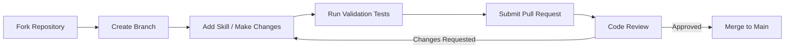

# How to Contribute to Agent Skills™

Thank you for your interest in contributing to the Agent Skills™ repository — the open-source skill library powering googleadsagent.ai™ and the Buddy™ Agent ecosystem. Whether you're adding a new skill, improving an existing one, translating documentation, or fixing a bug, your contribution helps the entire community of AI-assisted developers build better, faster, and smarter.

This guide walks you through every step of the contribution process so you can get your changes merged with minimal friction.

---

## How to Add a Skill

Adding a new skill is the most common and most impactful way to contribute. Follow these steps:

1. **Fork the repository**
   Navigate to [itallstartedwithaidea/agent-skills](https://github.com/itallstartedwithaidea/agent-skills) and click the **Fork** button in the top-right corner to create your own copy.

2. **Clone your fork locally**
   ```bash
   git clone https://github.com/YOUR-USERNAME/agent-skills.git
   cd agent-skills
   ```

3. **Create a new branch**
   ```bash
   git checkout -b add-skill/your-skill-name
   ```

4. **Create a directory for your skill**
   Skills are organized by category. Choose the appropriate category directory under `skills/` and create a new subdirectory for your skill:
   ```bash
   mkdir -p skills/category-name/your-skill-name
   ```
   Available categories:
   - `advertising` — Google Ads, Meta Ads, campaign management
   - `analytics` — Reporting, data analysis, attribution
   - `content` — Copywriting, creative generation, asset management
   - `development` — Code generation, debugging, deployment
   - `ecommerce` — Shopping feeds, product management, Merchant Center
   - `integrations` — Third-party API connections and data syncing
   - `optimization` — Bidding, budgets, performance tuning
   - `seo` — Search engine optimization, keyword research
   - `social` — Social media management and automation
   - `utilities` — General-purpose helper skills

5. **Create a `SKILL.md` file**
   Inside your new directory, create a `SKILL.md` file following the format specification described below.

6. **Validate your skill locally**
   ```bash
   bash scripts/validate-skills.sh
   ```

7. **Commit and push**
   ```bash
   git add .
   git commit -m "feat: add your-skill-name skill"
   git push origin add-skill/your-skill-name
   ```

8. **Submit a Pull Request**
   Go to your fork on GitHub and open a Pull Request against the `main` branch of `itallstartedwithaidea/agent-skills`.

---

## SKILL.md Format

Every skill must include a `SKILL.md` file that adheres to the following structure. This standard format ensures skills are discoverable, parseable, and compatible with the Agent Skills™ loader.

### Required Sections

```markdown
# Skill Name

## Description
A clear, concise description of what the skill does, what problem it solves,
and who it is intended for.

## Use Cases
- Use case one with a concrete scenario
- Use case two with a concrete scenario
- Use case three with a concrete scenario

## Platform Compatibility
| Platform     | Supported |
|--------------|-----------|
| Cursor       | ✅        |
| Claude Code  | ✅        |
| Codex        | ✅        |
| Gemini CLI   | ✅        |

## Examples
\```bash
# Example invocation or usage
agent execute --skill your-skill-name --input "sample input"
\```

## Related Skills
- [Related Skill One](../category/related-skill-one/)
- [Related Skill Two](../category/related-skill-two/)
```

### Optional Sections

- `## Prerequisites` — Required tools, APIs, or credentials.
- `## Configuration` — Environment variables or configuration files.
- `## Limitations` — Known constraints or unsupported scenarios.

For the full specification with annotated examples, see [docs/skill-format.md](docs/skill-format.md).

---

## Translation Guide

We maintain translated versions of the repository README to make Agent Skills™ accessible to a global audience. Translations are welcome in the following seven languages:

| Language | File Name       | Language Code |
|----------|-----------------|---------------|
| English  | `README.md`     | `en`          |
| French   | `README.fr.md`  | `fr`          |
| Spanish  | `README.es.md`  | `es`          |
| Chinese  | `README.zh.md`  | `zh`          |
| Dutch    | `README.nl.md`  | `nl`          |
| Russian  | `README.ru.md`  | `ru`          |
| Korean   | `README.ko.md`  | `ko`          |

### Translation Guidelines

1. **File naming**: Use the convention `README.xx.md` where `xx` is the ISO 639-1 language code.
2. **Keep the structure identical**: All headings, links, tables, and Mermaid diagrams must be preserved. Only translate the natural-language text.
3. **Do not translate**: Brand names (googleadsagent.ai™, Buddy™ Agent, Agent Skills™), code blocks, file paths, or command-line examples.
4. **Add a language header**: At the top of the translated file, include a note linking back to the English original and listing all available translations.
5. **Submit as a separate PR**: Translation PRs should be standalone to simplify review.

---

## PR Process

All contributions follow the standard fork-and-pull-request workflow:

1. **Fork** the repository to your own GitHub account.
2. **Branch** from `main` with a descriptive branch name:
   - `add-skill/skill-name` for new skills
   - `fix/description` for bug fixes
   - `docs/description` for documentation changes
   - `translate/language-code` for translations
3. **Commit** your changes with clear, conventional commit messages:
   - `feat: add campaign-budget-optimizer skill`
   - `fix: correct validation script exit code`
   - `docs: update architecture diagram`
   - `translate: add French README`
4. **Push** your branch to your fork.
5. **Open a Pull Request** against `main` on the upstream repository.
6. **Review**: A maintainer will review your PR. You may be asked to make changes. Once approved, your PR will be merged.

### Contribution Workflow



---

## Code of Conduct

All contributors are expected to adhere to our [Code of Conduct](CODE_OF_CONDUCT.md). By participating in this project, you agree to abide by its terms. We are committed to providing a welcoming and inclusive environment for everyone.

---

Thank you for contributing to Agent Skills™. Together we are building the definitive open-source skill library for AI-powered agents.
