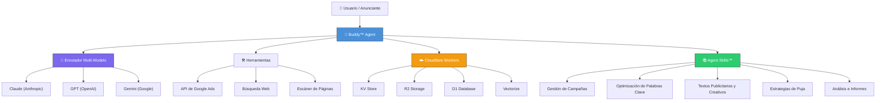
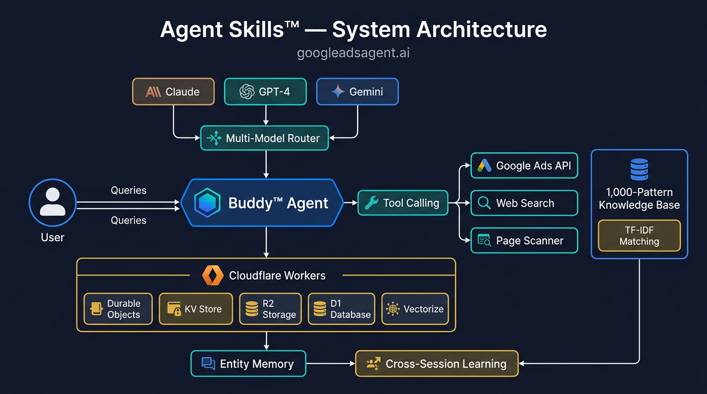

# Agent Skills™ — La biblioteca definitiva de habilidades para agentes IA

   

[English](README.md) | [Français](README.fr.md) | **Español** | [中文](README.zh.md) | [Nederlands](README.nl.md) | [Русский](README.ru.md) | [한국어](README.ko.md)


---

## ¿Qué es Agent Skills™?

**Agent Skills™** es la biblioteca definitiva de habilidades de código abierto para la gestión de Google Ads impulsada por inteligencia artificial, diseñada específicamente para la plataforma [googleadsagent.ai™](https://googleadsagent.ai). Este repositorio proporciona **más de 73 habilidades listas para producción en 10 categorías**, permitiendo que los agentes de IA gestionen, optimicen y escalen campañas de Google Ads de forma autónoma con precisión de nivel experto. Ya sea que estés construyendo flujos de trabajo de IA personalizados en Cursor, Claude Code, Codex o Gemini, Agent Skills™ ofrece el conocimiento estructurado y los patrones ejecutables que tu agente necesita para superar la gestión manual de campañas.

Agent Skills™ fue sintetizado a partir de la inteligencia colectiva de **más de 15 repositorios de código abierto de primer nivel** — incluyendo obra/superpowers (146k estrellas), affaan-m/everything-claude-code (150k estrellas), K-Dense-AI/scientific-agent-skills (18k estrellas), vercel-labs/agent-skills (24,8k estrellas) y más — destilando las mejores prácticas en arquitectura de agentes, llamadas a herramientas y automatización de IA específica de dominio en una biblioteca única, bien organizada y multilingüe. Cada habilidad sigue un formato estandarizado `SKILL.md`, está rigurosamente validada y está diseñada para su implementación inmediata con Buddy™ Agent, el orquestador inteligente en el corazón de googleadsagent.ai™.

---

## Arquitectura

La plataforma googleadsagent.ai™ está impulsada por Buddy™ Agent, un orquestador de IA multi-modelo que aprovecha Agent Skills™ para ofrecer gestión autónoma de Google Ads a escala.





---

## Catálogo de Habilidades

Agent Skills™ organiza **más de 73 habilidades** en **10 categorías**, cada una orientada a un dominio crítico de la gestión de Google Ads y las operaciones de agentes IA.


| Categoría | Habilidades | Descripción |
|-----------|-------------|-------------|
| [Gestión de Campañas](skills/campaign-management/) | 12 | Crear, pausar, optimizar y estructurar campañas de Búsqueda, Display, PMax y Video |
| [Optimización de Palabras Clave](skills/keyword-optimization/) | 9 | Investigación de palabras clave, extracción de palabras clave negativas, estrategia de tipos de concordancia y análisis de términos de búsqueda |
| [Textos Publicitarios y Creativos](skills/ad-copy-creative/) | 8 | Generación de RSA, optimización de títulos, redacción de descripciones y marcos de pruebas A/B |
| [Estrategias de Puja](skills/bidding-strategies/) | 7 | Configuración de Smart Bidding, ajuste de tROAS/tCPA, estrategias de cartera y ajustes de pujas |
| [Análisis e Informes](skills/analytics-reporting/) | 8 | Paneles personalizados, alertas de rendimiento, modelado de atribución e insights multicanal |
| [Segmentación de Audiencias](skills/audience-targeting/) | 6 | Listas de remarketing, Customer Match, audiencias similares y segmentación demográfica |
| [Gestión de Presupuesto](skills/budget-management/) | 5 | Asignación presupuestaria, ritmo de gasto, previsiones y optimización de presupuestos compartidos |
| [Página de Destino y CRO](skills/landing-page-cro/) | 6 | Análisis de páginas de destino, optimización de tasa de conversión, auditoría de velocidad de página |
| [Salud de la Cuenta](skills/account-health/) | 7 | Mejora del Quality Score, cumplimiento de políticas, auditorías de estructura de cuenta |
| [Infraestructura de Agentes](skills/agent-infrastructure/) | 5 | Configuración de servidor MCP, patrones de llamadas a herramientas, enrutamiento multi-modelo, gestión de memoria |

---

## Inicio Rápido

### Cursor

```bash
/add-plugin agent-skills
```

### Claude Code

```bash
/plugin install agent-skills
```

### npm

```bash
npx skills add itallstartedwithaidea/agent-skills
```

### Instalación Manual

```bash
git clone https://github.com/itallstartedwithaidea/agent-skills.git
cd agent-skills
```

Después de la instalación, las habilidades están disponibles en el contexto de tu agente. Cada habilidad es un archivo `SKILL.md` autónomo que tu agente IA carga bajo demanda.

---

## La Plataforma googleadsagent.ai™

[googleadsagent.ai™](https://googleadsagent.ai) es la plataforma nativa de IA para la gestión de Google Ads, diseñada para agencias, marcas de e-commerce y especialistas en marketing de rendimiento que exigen optimización de campañas autónoma y de nivel experto.

### Buddy™ Agent

**Buddy™ Agent** es el orquestador inteligente en el núcleo de googleadsagent.ai™. Buddy™ Agent combina:

- **Base de Conocimiento de 1.000 Patrones** — Curada a partir de millones de cuentas de Google Ads, codificando las mejores prácticas para cada tipo de campaña, vertical de industria y escenario de optimización
- **Enrutamiento Multi-Modelo** — Selecciona dinámicamente el LLM óptimo (Claude, GPT, Gemini) para cada tarea basándose en costo, latencia y requisitos de capacidad
- **Memoria de Entidades** — Memoria persistente y estructurada que rastrea el historial de la cuenta, las decisiones de optimización y las tendencias de rendimiento entre sesiones
- **Llamadas a Herramientas** — Integración nativa con la API de Google Ads, búsqueda web, escáneres de páginas y Cloudflare Workers para la recuperación de datos y ejecución de acciones en tiempo real
- **Integración Agent Skills™** — Carga habilidades de este repositorio bajo demanda, proporcionando a Buddy™ Agent experiencia profunda en las 10 categorías

---

## Contribuir

¡Damos la bienvenida a las contribuciones de la comunidad! Ya sea que quieras añadir una nueva habilidad, mejorar una existente, corregir un error o traducir contenido a un nuevo idioma, tu ayuda hace que Agent Skills™ sea mejor para todos.

Por favor, lee nuestra [Guía de Contribución](CONTRIBUTING.md) antes de enviar un pull request.

---

## Créditos y Atribución

Agent Skills™ fue construido sobre los hombros de gigantes. Agradecemos con gratitud los siguientes repositorios de código abierto cuyo trabajo informó e inspiró esta biblioteca:

| Repositorio | Estrellas | Lo que sintetizamos |
|-------------|-----------|---------------------|
| [obra/superpowers](https://github.com/obra/superpowers) | 146k | Patrones de arquitectura de agentes, diseño de flujos de trabajo autónomos |
| [affaan-m/everything-claude-code](https://github.com/affaan-m/everything-claude-code) | 150k | Mejores prácticas de Claude Code, patrones de ingeniería de prompts |
| [vercel-labs/agent-skills](https://github.com/vercel-labs/agent-skills) | 24,8k | Especificación del formato de habilidades, arquitectura de plugins |
| [K-Dense-AI/scientific-agent-skills](https://github.com/K-Dense-AI/scientific-agent-skills) | 18k | Metodología científica para validación y prueba de habilidades |
| [agentskills/agentskills](https://github.com/agentskills/agentskills) | — | Taxonomía y marco de categorización de habilidades |
| [addyosmani/agent-skills](https://github.com/addyosmani/agent-skills) | — | Patrones de habilidades de rendimiento web y optimización |
| [remotion-dev/skills](https://github.com/remotion-dev/skills) | — | Habilidades de generación de medios y automatización creativa |
| [huggingface/skills](https://github.com/huggingface/skills) | — | Integración de modelos ML y patrones de habilidades de inferencia |
| [bytedance/deer-flow](https://github.com/bytedance/deer-flow) | — | Patrones de orquestación de flujos multi-agente |
| [jeecgboot/JeecgBoot](https://github.com/jeecgboot/JeecgBoot) | — | Automatización low-code y patrones de desarrollo rápido |
| [CherryHQ/cherry-studio](https://github.com/CherryHQ/cherry-studio) | — | Interfaz de chat multi-modelo y diseño de interacción de agentes |
| [hesreallyhim/awesome-claude-code](https://github.com/hesreallyhim/awesome-claude-code) | — | Herramientas del ecosistema Claude Code y patrones de integración |
| [alibaba/nacos](https://github.com/alibaba/nacos) | — | Patrones de descubrimiento de servicios y gestión de configuración |
| [sickn33/antigravity-awesome-skills](https://github.com/sickn33/antigravity-awesome-skills) | — | Composición y encadenamiento avanzado de habilidades de agentes |
| [vercel-labs/skills](https://github.com/vercel-labs/skills) | — | Empaquetado y distribución de habilidades listas para despliegue |

---

## Licencia

Este proyecto está bajo la [Licencia MIT](LICENSE).

---

<p align="center">
  Construido con ❤️ por <a href="https://github.com/itallstartedwithaidea">itallstartedwithaidea</a> | Impulsado por <a href="https://googleadsagent.ai">googleadsagent.ai™</a>
</p>

---

### Palabras Clave

agent skills, google ads ia, agente ia, automatización google ads, buddy agent, googleadsagent, habilidades claude code, habilidades cursor, habilidades codex, habilidades gemini, servidor mcp, cloudflare workers, api google ads, gestión de campañas ia, optimización de palabras clave ia, generación de textos publicitarios, estrategia de pujas ia, automatización ppc, automatización sem, publicidad digital ia, agente ia multi-modelo, orquestación de agentes, llamadas a herramientas, plataforma de gestión google ads
