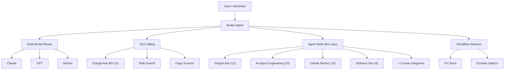

<p align="center">
  
</p>

<p align="center">
  <strong>73 habilidades listas para producción para la gestión de Google Ads con IA.</strong><br>
  Desarrollado para <a href="https://googleadsagent.ai/tools/auditor/app">Buddy Agent</a> en <a href="https://googleadsagent.ai">googleadsagent.ai</a>. Compatible con Claude Code, Cursor, Codex y Gemini.
</p>

[English](README.md) | [Francais](README.fr.md) | [Espanol](README.es.md) | [中文](README.zh.md) | [Nederlands](README.nl.md) | [Русский](README.ru.md) | [한국어](README.ko.md)

---

## ¿Cómo es una habilidad?

Cada habilidad es un único archivo `SKILL.md` dentro de un directorio con nombre. Aquí tienes una habilidad real de este repositorio — **Keyword Research** (`skills/google-ads/keyword-research/SKILL.md`):

```markdown
# Keyword Research

## Description

Systematic keyword discovery, expansion, and optimization for Google Ads.
Builds keyword universes from seed keywords through semantic expansion,
competitor mining, search term analysis, and intent-based grouping.
Assigns match types based on conversion probability and manages negative
keyword lists at account, campaign, and ad group levels.

## Use When

- User asks for "keyword research" or "keyword ideas"
- User wants to "expand keywords" or "find new keywords"
- User mentions "negative keywords" or "search term mining"
- User asks about "match types" (broad, phrase, exact)
- User wants to "reduce wasted spend" on irrelevant queries

## Implementation

​```javascript
function assignMatchType(keyword) {
  if (keyword.conversionRate > 0.05 && keyword.volume < 1000)
    return 'EXACT';
  if (keyword.intent === 'transactional' && keyword.wordCount >= 3)
    return 'PHRASE';
  if (keyword.volume > 5000 && keyword.competitorPresence)
    return 'BROAD';
  return 'PHRASE';
}
​```

## Platform Compatibility

| Platform    | Supported |
|-------------|-----------|
| Cursor      | ✅        |
| Claude Code | ✅        |
| Codex       | ✅        |
| Gemini CLI  | ✅        |

## Related Skills

- [Ad Copy Generation](../google-ads/ad-copy-generation/)
- [Competitor Analysis](../google-ads/competitor-analysis/)
- [Quality Score Optimization](../google-ads/quality-score-optimization/)
```

Ese es el formato completo. Cada habilidad sigue esta estructura:

<p align="center">
  
</p>

Consulta la [especificación completa del formato](docs/skill-format.md) para más detalles.

---

## Inicio rápido

### Clonar y usar directamente

```bash
git clone https://github.com/itallstartedwithaidea/agent-skills.git
cd agent-skills
```

### Validar todas las habilidades

```bash
npm run validate
```

### Contar habilidades por categoría

```bash
npm run count
```

Después de clonar, apunta tu agente de IA al directorio `skills/`. Cada `SKILL.md` es autónomo y se puede cargar bajo demanda.

---

## Catálogo de habilidades

73 habilidades en 10 categorías:

| Categoría | Habilidades | Qué cubre |
|-----------|-------------|-----------|
| [Google Ads](skills/google-ads/) | 12 | Auditorías, palabras clave, textos de anuncios, pujas, PMax, Shopping, audiencias, conversiones, presupuestos, Quality Score, remarketing, análisis de competencia |
| [AI Agent Engineering](skills/ai-agent-engineering/) | 10 | Inyección de base de conocimientos, memoria de entidades, enrutamiento multi-modelo, inteligencia proactiva, servidores MCP, orquestación paralela |
| [Claude Mythos](skills/claude-mythos/) | 10 | Arquitectura de prompts, ingeniería de contexto, dominio de herramientas, agentes auto-reparables, bucles de verificación, andamiaje cognitivo |
| [Software Development](skills/software-dev/) | 8 | Revisión de código, TDD, depuración sistemática, git worktrees, brainstorming, desarrollo dirigido por subagentes |
| [Scientific Research](skills/scientific-research/) | 8 | Análisis de datos, aprendizaje automático, bioinformática, quimioinformática, análisis geoespacial, redacción científica |
| [Web Frontend](skills/web-frontend/) | 6 | Buenas prácticas de React, React Native, transiciones de vista, despliegue en el borde, patrones de composición, diseño web |
| [Productivity](skills/productivity/) | 6 | Orquestación de flujos de trabajo, procesamiento por lotes, bases de conocimiento RAG, estudio de chat con IA, generación low-code |
| [Infrastructure](skills/infrastructure/) | 6 | Cloudflare Workers, pipelines CI/CD, renderizado en el borde, observabilidad, descubrimiento de servicios, gestión de configuración |
| [Security](skills/security/) | 4 | Escaneo de seguridad de agentes, CodeQL/Semgrep, endurecimiento de sandbox, protección de secretos |
| [Media Creative](skills/media-creative/) | 3 | Generación de assets web, vídeo programático, integración de modelos ML |

---

## Formato SKILL.md

Cada habilidad requiere las siguientes secciones:

| Sección | Propósito |
|---------|-----------|
| `# Title` | Nombre legible de la habilidad |
| `## Description` | Explicación de 2 a 5 frases (indexada para búsqueda) |
| `## Use When` | Lista con viñetas de escenarios desencadenantes |
| `## Implementation` | Fragmentos de código, algoritmos, procedimientos |
| `## Platform Compatibility` | Tabla de compatibilidad con Cursor / Claude Code / Codex / Gemini |
| `## Related Skills` | Enlaces a habilidades complementarias |

Opcional: `## Prerequisites`, `## Configuration`, `## Best Practices`, `## Limitations`, `## Keywords`

Especificación completa: [docs/skill-format.md](docs/skill-format.md)

---

## Arquitectura

Buddy Agent carga las habilidades bajo demanda según la coincidencia con la intención del usuario:



Documentación completa de la arquitectura: [docs/architecture.md](docs/architecture.md)

---

## La plataforma

[googleadsagent.ai](https://googleadsagent.ai) es la plataforma de gestión de Google Ads nativa de IA. **Buddy Agent** es el orquestador inteligente en su núcleo:

- **Base de conocimientos de 1.000 patrones** — Patrones expertos de Google Ads con coincidencia TF-IDF, inyectados en cada llamada de IA
- **Enrutamiento multi-modelo** — Claude, GPT y Gemini con llamada a herramientas en los tres proveedores
- **Memoria de entidades** — Memoria persistente que rastrea campañas, puntos de fricción, métricas y decisiones entre sesiones a través de Cloudflare KV
- **Inteligencia proactiva** — La IA busca autónomamente en la web y vuelve a obtener datos de Google Ads durante el análisis
- **Integración de Agent Skills** — Carga habilidades de este repositorio bajo demanda

---

## Contribuir

Las contribuciones son bienvenidas. Consulta [CONTRIBUTING.md](CONTRIBUTING.md) para las directrices.

Para añadir una nueva habilidad:

1. Crea un directorio bajo la categoría apropiada en `skills/`
2. Añade un `SKILL.md` siguiendo la [especificación del formato](docs/skill-format.md)
3. Ejecuta `npm run validate` para confirmar que pasa las validaciones
4. Envía un pull request

---

## Créditos

Agent Skills se inspiró en estos proyectos de código abierto:

| Repositorio | Estrellas | Lo que aprendimos |
|-------------|-----------|-------------------|
| [obra/superpowers](https://github.com/obra/superpowers) | 148k | Arquitectura de agentes, diseño de flujos de trabajo autónomos |
| [affaan-m/everything-claude-code](https://github.com/affaan-m/everything-claude-code) | 152k | Buenas prácticas de Claude Code, ingeniería de prompts |
| [vercel-labs/agent-skills](https://github.com/vercel-labs/agent-skills) | 25k | Especificación del formato de habilidades, arquitectura de plugins |
| [K-Dense-AI/scientific-agent-skills](https://github.com/K-Dense-AI/scientific-agent-skills) | 18k | Metodología científica para la validación de habilidades |

---

## Licencia

Licencia MIT. Ver [LICENSE](LICENSE).

---

Creado por [John Williams](https://itallstartedwithaidea.com) | Impulsado por [googleadsagent.ai](https://googleadsagent.ai)
