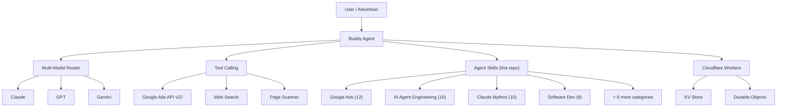

<p align="center">
  
</p>

<p align="center">
  <strong>73 compétences prêtes pour la production pour la gestion Google Ads par IA.</strong><br>
  Conçu pour <a href="https://googleadsagent.ai/tools/auditor/app">Buddy Agent</a> sur <a href="https://googleadsagent.ai">googleadsagent.ai</a>. Compatible avec Claude Code, Cursor, Codex et Gemini.
</p>

[English](README.md) | [Francais](README.fr.md) | [Espanol](README.es.md) | [中文](README.zh.md) | [Nederlands](README.nl.md) | [Русский](README.ru.md) | [한국어](README.ko.md)

---

## À quoi ressemble une compétence ?

Chaque compétence est un simple fichier `SKILL.md` dans un répertoire nommé. Voici une compétence réelle de ce dépôt — **Keyword Research** (`skills/google-ads/keyword-research/SKILL.md`) :

```markdown
# Keyword Research

## Description

Systematic keyword discovery, expansion, and optimization for Google Ads.
Builds keyword universes from seed keywords through semantic expansion,
competitor mining, search term analysis, and intent-based grouping.
Assigns match types based on conversion probability and manages negative
keyword lists at account, campaign, and ad group levels.

## Use When

- User asks for "keyword research" or "keyword ideas"
- User wants to "expand keywords" or "find new keywords"
- User mentions "negative keywords" or "search term mining"
- User asks about "match types" (broad, phrase, exact)
- User wants to "reduce wasted spend" on irrelevant queries

## Implementation

​```javascript
function assignMatchType(keyword) {
  if (keyword.conversionRate > 0.05 && keyword.volume < 1000)
    return 'EXACT';
  if (keyword.intent === 'transactional' && keyword.wordCount >= 3)
    return 'PHRASE';
  if (keyword.volume > 5000 && keyword.competitorPresence)
    return 'BROAD';
  return 'PHRASE';
}
​```

## Platform Compatibility

| Platform    | Supported |
|-------------|-----------|
| Cursor      | ✅        |
| Claude Code | ✅        |
| Codex       | ✅        |
| Gemini CLI  | ✅        |

## Related Skills

- [Ad Copy Generation](../google-ads/ad-copy-generation/)
- [Competitor Analysis](../google-ads/competitor-analysis/)
- [Quality Score Optimization](../google-ads/quality-score-optimization/)
```

Voilà le format complet. Chaque compétence suit cette structure :

<p align="center">
  
</p>

Consultez la [spécification complète du format](docs/skill-format.md) pour plus de détails.

---

## Démarrage rapide

### Cloner et utiliser directement

```bash
git clone https://github.com/itallstartedwithaidea/agent-skills.git
cd agent-skills
```

### Valider toutes les compétences

```bash
npm run validate
```

### Compter les compétences par catégorie

```bash
npm run count
```

Après le clonage, dirigez votre agent IA vers le répertoire `skills/`. Chaque `SKILL.md` est autonome et chargeable à la demande.

---

## Catalogue des compétences

73 compétences réparties en 10 catégories :

| Catégorie | Compétences | Ce qu'elle couvre |
|-----------|-------------|-------------------|
| [Google Ads](skills/google-ads/) | 12 | Audits, mots-clés, textes publicitaires, enchères, PMax, Shopping, audiences, conversions, budgets, Quality Score, remarketing, analyse concurrentielle |
| [AI Agent Engineering](skills/ai-agent-engineering/) | 10 | Injection de base de connaissances, mémoire d'entités, routage multi-modèles, intelligence proactive, serveurs MCP, orchestration parallèle |
| [Claude Mythos](skills/claude-mythos/) | 10 | Architecture de prompts, ingénierie de contexte, maîtrise des outils, agents auto-réparateurs, boucles de vérification, échafaudage cognitif |
| [Software Development](skills/software-dev/) | 8 | Revue de code, TDD, débogage systématique, git worktrees, brainstorming, développement piloté par sous-agents |
| [Scientific Research](skills/scientific-research/) | 8 | Analyse de données, apprentissage automatique, bio-informatique, chimio-informatique, analyse géospatiale, rédaction scientifique |
| [Web Frontend](skills/web-frontend/) | 6 | Bonnes pratiques React, React Native, transitions de vues, déploiement en périphérie, patterns de composition, design web |
| [Productivity](skills/productivity/) | 6 | Orchestration de flux de travail, traitement par lots, bases de connaissances RAG, studio de chat IA, génération low-code |
| [Infrastructure](skills/infrastructure/) | 6 | Cloudflare Workers, pipelines CI/CD, rendu en périphérie, observabilité, découverte de services, gestion de configuration |
| [Security](skills/security/) | 4 | Scan de sécurité des agents, CodeQL/Semgrep, durcissement de sandbox, protection des secrets |
| [Media Creative](skills/media-creative/) | 3 | Génération d'assets web, vidéo programmatique, intégration de modèles ML |

---

## Format SKILL.md

Chaque compétence nécessite les sections suivantes :

| Section | Objectif |
|---------|----------|
| `# Title` | Nom lisible de la compétence |
| `## Description` | Explication en 2 à 5 phrases (indexée pour la recherche) |
| `## Use When` | Liste à puces des scénarios déclencheurs |
| `## Implementation` | Extraits de code, algorithmes, procédures |
| `## Platform Compatibility` | Tableau de compatibilité Cursor / Claude Code / Codex / Gemini |
| `## Related Skills` | Liens vers les compétences complémentaires |

Optionnel : `## Prerequisites`, `## Configuration`, `## Best Practices`, `## Limitations`, `## Keywords`

Spécification complète : [docs/skill-format.md](docs/skill-format.md)

---

## Architecture

Buddy Agent charge les compétences à la demande en fonction de la correspondance avec l'intention de l'utilisateur :



Documentation complète de l'architecture : [docs/architecture.md](docs/architecture.md)

---

## La plateforme

[googleadsagent.ai](https://googleadsagent.ai) est la plateforme de gestion Google Ads nativement IA. **Buddy Agent** est l'orchestrateur intelligent à son cœur :

- **Base de connaissances de 1 000 patterns** — Patterns experts Google Ads avec correspondance TF-IDF, injectés dans chaque appel IA
- **Routage multi-modèles** — Claude, GPT et Gemini avec appel d'outils sur les trois fournisseurs
- **Mémoire d'entités** — Mémoire persistante suivant les campagnes, points de friction, métriques et décisions entre les sessions via Cloudflare KV
- **Intelligence proactive** — L'IA recherche autonomement sur le web et re-récupère les données Google Ads en cours d'analyse
- **Intégration Agent Skills** — Charge les compétences de ce dépôt à la demande

---

## Contribuer

Les contributions sont les bienvenues. Consultez [CONTRIBUTING.md](CONTRIBUTING.md) pour les directives.

Pour ajouter une nouvelle compétence :

1. Créez un répertoire sous la catégorie appropriée dans `skills/`
2. Ajoutez un `SKILL.md` en suivant la [spécification du format](docs/skill-format.md)
3. Exécutez `npm run validate` pour vérifier qu'il passe les tests
4. Soumettez une pull request

---

## Remerciements

Agent Skills s'est inspiré de ces projets open source :

| Dépôt | Étoiles | Ce que nous avons appris |
|-------|---------|--------------------------|
| [obra/superpowers](https://github.com/obra/superpowers) | 148k | Architecture d'agents, conception de flux de travail autonomes |
| [affaan-m/everything-claude-code](https://github.com/affaan-m/everything-claude-code) | 152k | Bonnes pratiques Claude Code, ingénierie de prompts |
| [vercel-labs/agent-skills](https://github.com/vercel-labs/agent-skills) | 25k | Spécification du format des compétences, architecture de plugins |
| [K-Dense-AI/scientific-agent-skills](https://github.com/K-Dense-AI/scientific-agent-skills) | 18k | Méthodologie scientifique pour la validation des compétences |

---

## Licence

Licence MIT. Voir [LICENSE](LICENSE).

---

Créé par [John Williams](https://itallstartedwithaidea.com) | Propulsé par [googleadsagent.ai](https://googleadsagent.ai)
