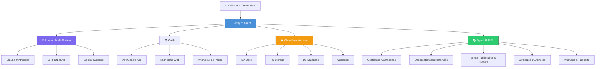
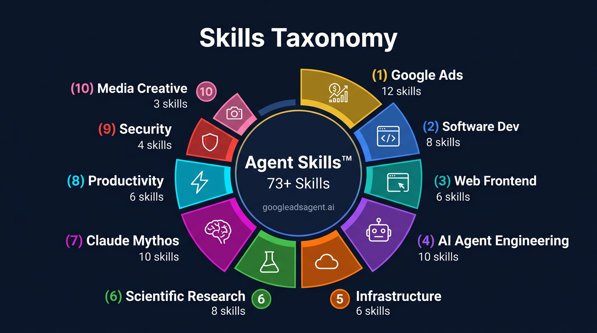

# Agent Skills™ — La bibliothèque de compétences IA de référence

   

[English](README.md) | **Français** | [Español](README.es.md) | [中文](README.zh.md) | [Nederlands](README.nl.md) | [Русский](README.ru.md) | [한국어](README.ko.md)


---

## Qu'est-ce qu'Agent Skills™ ?

**Agent Skills™** est la bibliothèque de compétences open source de référence pour la gestion automatisée de Google Ads par intelligence artificielle, spécialement conçue pour la plateforme [googleadsagent.ai™](https://googleadsagent.ai). Ce dépôt fournit **plus de 73 compétences prêtes pour la production, réparties en 10 catégories**, permettant aux agents IA de gérer, optimiser et développer de manière autonome les campagnes Google Ads avec une précision de niveau expert. Que vous construisiez des flux de travail IA personnalisés dans Cursor, Claude Code, Codex ou Gemini, Agent Skills™ offre à votre agent les connaissances structurées et les modèles exécutables nécessaires pour surpasser la gestion manuelle de campagnes.

Agent Skills™ a été synthétisé à partir de l'intelligence collective de **plus de 15 dépôts open source de premier plan** — dont obra/superpowers (146k étoiles), affaan-m/everything-claude-code (150k étoiles), K-Dense-AI/scientific-agent-skills (18k étoiles), vercel-labs/agent-skills (24,8k étoiles), et bien d'autres — en distillant les meilleures pratiques en architecture d'agents, appels d'outils et automatisation IA spécialisée dans une bibliothèque unique, bien organisée et multilingue. Chaque compétence suit un format standardisé `SKILL.md`, est rigoureusement validée et est conçue pour un déploiement plug-and-play instantané avec Buddy™ Agent, l'orchestrateur intelligent au cœur de googleadsagent.ai™.

---

## Architecture

La plateforme googleadsagent.ai™ est propulsée par Buddy™ Agent, un orchestrateur IA multi-modèle qui exploite Agent Skills™ pour offrir une gestion autonome de Google Ads à grande échelle.




---

## Catalogue des Compétences

Agent Skills™ organise **plus de 73 compétences** en **10 catégories**, chacune ciblant un domaine essentiel de la gestion Google Ads et des opérations d'agents IA.



| Catégorie | Compétences | Description |
|-----------|-------------|-------------|
| [Gestion de Campagnes](skills/campaign-management/) | 12 | Créer, mettre en pause, optimiser et structurer les campagnes Search, Display, PMax et Vidéo |
| [Optimisation des Mots-Clés](skills/keyword-optimization/) | 9 | Recherche de mots-clés, extraction de mots-clés négatifs, stratégie de types de correspondance et analyse des termes de recherche |
| [Textes Publicitaires & Créatifs](skills/ad-copy-creative/) | 8 | Génération de RSA, optimisation des titres, rédaction de descriptions et cadres de tests A/B |
| [Stratégies d'Enchères](skills/bidding-strategies/) | 7 | Configuration Smart Bidding, ajustement tROAS/tCPA, stratégies de portefeuille et ajustements d'enchères |
| [Analyses & Rapports](skills/analytics-reporting/) | 8 | Tableaux de bord personnalisés, alertes de performance, modélisation d'attribution et insights cross-canal |
| [Ciblage d'Audience](skills/audience-targeting/) | 6 | Listes de remarketing, Customer Match, audiences similaires et ciblage démographique |
| [Gestion du Budget](skills/budget-management/) | 5 | Allocation budgétaire, rythme de dépense, prévisions et optimisation des budgets partagés |
| [Page d'Atterrissage & CRO](skills/landing-page-cro/) | 6 | Analyse de pages d'atterrissage, optimisation du taux de conversion, audit de vitesse de page |
| [Santé du Compte](skills/account-health/) | 7 | Amélioration du Quality Score, conformité aux politiques, audits de structure de compte |
| [Infrastructure Agent](skills/agent-infrastructure/) | 5 | Configuration de serveur MCP, modèles d'appels d'outils, routage multi-modèle, gestion de la mémoire |

---

## Démarrage Rapide

### Cursor

```bash
/add-plugin agent-skills
```

### Claude Code

```bash
/plugin install agent-skills
```

### npm

```bash
npx skills add itallstartedwithaidea/agent-skills
```

### Installation Manuelle

```bash
git clone https://github.com/itallstartedwithaidea/agent-skills.git
cd agent-skills
```

Après l'installation, les compétences sont disponibles dans le contexte de votre agent. Chaque compétence est un fichier `SKILL.md` autonome que votre agent IA charge à la demande.

---

## La Plateforme googleadsagent.ai™

[googleadsagent.ai™](https://googleadsagent.ai) est la plateforme de gestion Google Ads native IA, conçue pour les agences, les marques e-commerce et les spécialistes du marketing de performance qui exigent une optimisation de campagnes autonome et de niveau expert.

### Buddy™ Agent

**Buddy™ Agent** est l'orchestrateur intelligent au cœur de googleadsagent.ai™. Buddy™ Agent combine :

- **Base de Connaissances de 1 000 Modèles** — Sélectionnée à partir de millions de comptes Google Ads, encodant les meilleures pratiques pour chaque type de campagne, secteur vertical et scénario d'optimisation
- **Routage Multi-Modèle** — Sélectionne dynamiquement le LLM optimal (Claude, GPT, Gemini) pour chaque tâche en fonction du coût, de la latence et des capacités requises
- **Mémoire d'Entités** — Mémoire persistante et structurée qui suit l'historique du compte, les décisions d'optimisation et les tendances de performance entre les sessions
- **Appels d'Outils** — Intégration native avec l'API Google Ads, la recherche web, les analyseurs de pages et Cloudflare Workers pour la récupération de données et l'exécution d'actions en temps réel
- **Intégration Agent Skills™** — Charge les compétences de ce dépôt à la demande, donnant à Buddy™ Agent une expertise approfondie dans les 10 catégories

---

## Contribuer

Nous accueillons les contributions de la communauté ! Que vous souhaitiez ajouter une nouvelle compétence, améliorer une compétence existante, corriger un bug ou traduire du contenu dans une nouvelle langue, votre aide rend Agent Skills™ meilleur pour tous.

Veuillez lire notre [Guide de Contribution](CONTRIBUTING.md) avant de soumettre une pull request.

---

## Crédits & Attribution

Agent Skills™ a été construit sur les épaules de géants. Nous remercions chaleureusement les dépôts open source suivants dont le travail a informé et inspiré cette bibliothèque :

| Dépôt | Étoiles | Ce que nous avons synthétisé |
|-------|---------|------------------------------|
| [obra/superpowers](https://github.com/obra/superpowers) | 146k | Modèles d'architecture d'agents, conception de flux de travail autonomes |
| [affaan-m/everything-claude-code](https://github.com/affaan-m/everything-claude-code) | 150k | Meilleures pratiques Claude Code, modèles d'ingénierie de prompts |
| [vercel-labs/agent-skills](https://github.com/vercel-labs/agent-skills) | 24,8k | Spécification du format de compétences, architecture de plugins |
| [K-Dense-AI/scientific-agent-skills](https://github.com/K-Dense-AI/scientific-agent-skills) | 18k | Méthodologie scientifique pour la validation et le test des compétences |
| [agentskills/agentskills](https://github.com/agentskills/agentskills) | — | Taxonomie et cadre de catégorisation des compétences |
| [addyosmani/agent-skills](https://github.com/addyosmani/agent-skills) | — | Modèles de compétences en performance web et optimisation |
| [remotion-dev/skills](https://github.com/remotion-dev/skills) | — | Compétences en génération de médias et automatisation créative |
| [huggingface/skills](https://github.com/huggingface/skills) | — | Intégration de modèles ML et modèles de compétences d'inférence |
| [bytedance/deer-flow](https://github.com/bytedance/deer-flow) | — | Modèles d'orchestration de flux multi-agents |
| [jeecgboot/JeecgBoot](https://github.com/jeecgboot/JeecgBoot) | — | Automatisation low-code et modèles de développement rapide |
| [CherryHQ/cherry-studio](https://github.com/CherryHQ/cherry-studio) | — | Interface de chat multi-modèle et conception d'interaction agent |
| [hesreallyhim/awesome-claude-code](https://github.com/hesreallyhim/awesome-claude-code) | — | Outils de l'écosystème Claude Code et modèles d'intégration |
| [alibaba/nacos](https://github.com/alibaba/nacos) | — | Modèles de découverte de services et gestion de configuration |
| [sickn33/antigravity-awesome-skills](https://github.com/sickn33/antigravity-awesome-skills) | — | Composition et chaînage avancés de compétences agent |
| [vercel-labs/skills](https://github.com/vercel-labs/skills) | — | Packaging et distribution de compétences prêtes au déploiement |

---

## Licence

Ce projet est sous licence [MIT](LICENSE).

---

<p align="center">
  Construit avec ❤️ par <a href="https://github.com/itallstartedwithaidea">itallstartedwithaidea</a> | Propulsé par <a href="https://googleadsagent.ai">googleadsagent.ai™</a>
</p>

---

### Mots-Clés

agent skills, google ads ia, agent ia, automatisation google ads, buddy agent, googleadsagent, compétences claude code, compétences cursor, compétences codex, compétences gemini, serveur mcp, cloudflare workers, api google ads, gestion de campagnes ia, optimisation de mots-clés ia, génération de textes publicitaires, stratégie d'enchères ia, automatisation ppc, automatisation sem, publicité numérique ia, agent ia multi-modèle, orchestration d'agents, appels d'outils, plateforme de gestion google ads
