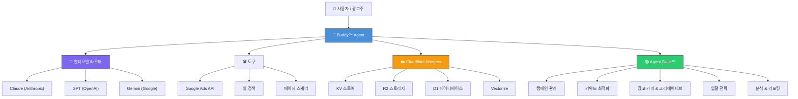

# Agent Skills™ — 최고 권위의 AI 에이전트 스킬 라이브러리

   

[English](README.md) | [Français](README.fr.md) | [Español](README.es.md) | [中文](README.zh.md) | [Nederlands](README.nl.md) | [Русский](README.ru.md) | **한국어**


---

## Agent Skills™란 무엇인가?

**Agent Skills™**는 AI 기반 Google Ads 관리를 위한 최고 권위의 오픈소스 스킬 라이브러리로, [googleadsagent.ai™](https://googleadsagent.ai) 플랫폼을 위해 특별히 구축되었습니다. 이 저장소는 **10개 카테고리에 걸친 73개 이상의 프로덕션 준비 스킬**을 제공하여, AI 에이전트가 전문가 수준의 정밀도로 Google Ads 캠페인을 자율적으로 관리, 최적화 및 확장할 수 있도록 합니다. Cursor, Claude Code, Codex 또는 Gemini에서 맞춤형 AI 워크플로우를 구축하든, Agent Skills™는 수동 캠페인 관리를 능가하는 데 필요한 구조화된 지식과 실행 가능한 패턴을 에이전트에 제공합니다.

Agent Skills™는 **15개 이상의 최고 수준 오픈소스 저장소**의 집단 지성을 종합하여 만들어졌습니다 — obra/superpowers(146k 스타), affaan-m/everything-claude-code(150k 스타), K-Dense-AI/scientific-agent-skills(18k 스타), vercel-labs/agent-skills(24.8k 스타) 등 — 에이전트 아키텍처, 도구 호출 및 도메인별 AI 자동화의 모범 사례를 하나의 잘 정리된 다국어 라이브러리로 정제했습니다. 모든 스킬은 표준화된 `SKILL.md` 형식을 따르며, 엄격하게 검증되었고, googleadsagent.ai™의 핵심인 지능형 오케스트레이터 Buddy™ Agent와 즉시 플러그 앤 플레이 배포가 가능하도록 설계되었습니다.

---

## 아키텍처

googleadsagent.ai™ 플랫폼은 Agent Skills™를 활용하여 대규모 자율 Google Ads 관리를 제공하는 멀티모델 AI 오케스트레이터인 Buddy™ Agent로 구동됩니다.




---

## 스킬 카탈로그

Agent Skills™는 **73개 이상의 스킬**을 **10개 카테고리**로 구성하며, 각 카테고리는 Google Ads 관리 및 AI 에이전트 운영의 핵심 영역을 대상으로 합니다.


| 카테고리 | 스킬 수 | 설명 |
|----------|---------|------|
| [캠페인 관리](skills/campaign-management/) | 12 | 검색, 디스플레이, PMax 및 비디오 캠페인 생성, 일시중지, 최적화 및 구조화 |
| [키워드 최적화](skills/keyword-optimization/) | 9 | 키워드 리서치, 제외 키워드 발굴, 검색어 유형 전략 및 검색어 분석 |
| [광고 카피 & 크리에이티브](skills/ad-copy-creative/) | 8 | RSA 생성, 헤드라인 최적화, 설명문 작성 및 A/B 테스트 프레임워크 |
| [입찰 전략](skills/bidding-strategies/) | 7 | Smart Bidding 구성, tROAS/tCPA 조정, 포트폴리오 전략 및 입찰 조정 |
| [분석 & 리포팅](skills/analytics-reporting/) | 8 | 맞춤 대시보드, 성과 알림, 기여 모델링 및 크로스채널 인사이트 |
| [오디언스 타겟팅](skills/audience-targeting/) | 6 | 리마케팅 목록, 고객 일치, 유사 잠재고객 및 인구통계 타겟팅 |
| [예산 관리](skills/budget-management/) | 5 | 예산 배분, 지출 페이싱, 예측 및 공유 예산 최적화 |
| [랜딩 페이지 & CRO](skills/landing-page-cro/) | 6 | 랜딩 페이지 분석, 전환율 최적화, 페이지 속도 감사 |
| [계정 건강](skills/account-health/) | 7 | 품질 점수 개선, 정책 준수, 계정 구조 감사 |
| [에이전트 인프라](skills/agent-infrastructure/) | 5 | MCP 서버 설정, 도구 호출 패턴, 멀티모델 라우팅, 메모리 관리 |

---

## 빠른 시작

### Cursor

```bash
/add-plugin agent-skills
```

### Claude Code

```bash
/plugin install agent-skills
```

### npm

```bash
npx skills add itallstartedwithaidea/agent-skills
```

### 수동 설치

```bash
git clone https://github.com/itallstartedwithaidea/agent-skills.git
cd agent-skills
```

설치 후 스킬은 에이전트의 컨텍스트에서 사용할 수 있습니다. 각 스킬은 AI 에이전트가 필요 시 로드하는 독립적인 `SKILL.md` 파일입니다.

---

## googleadsagent.ai™ 플랫폼

[googleadsagent.ai™](https://googleadsagent.ai)는 자율적인 전문가 수준의 캠페인 최적화를 요구하는 대행사, 이커머스 브랜드 및 퍼포먼스 마케터를 위해 구축된 AI 네이티브 Google Ads 관리 플랫폼입니다.

### Buddy™ Agent

**Buddy™ Agent**는 googleadsagent.ai™의 핵심에 있는 지능형 오케스트레이터입니다. Buddy™ Agent는 다음을 결합합니다:

- **1,000 패턴 지식 베이스** — 수백만 개의 Google Ads 계정에서 선별되어 모든 캠페인 유형, 산업 분야 및 최적화 시나리오에 대한 모범 사례를 인코딩
- **멀티모델 라우팅** — 비용, 지연 시간 및 기능 요구 사항에 따라 각 작업에 최적의 LLM(Claude, GPT, Gemini)을 동적으로 선택
- **엔티티 메모리** — 세션 간에 계정 이력, 최적화 결정 및 성과 추세를 추적하는 영구적이고 구조화된 메모리
- **도구 호출** — 실시간 데이터 검색 및 작업 실행을 위한 Google Ads API, 웹 검색, 페이지 스캐너 및 Cloudflare Workers와의 네이티브 통합
- **Agent Skills™ 통합** — 이 저장소에서 스킬을 필요 시 로드하여 Buddy™ Agent에 10개 전체 카테고리에 걸친 깊은 도메인 전문 지식 제공

---

## 기여하기

커뮤니티의 기여를 환영합니다! 새로운 스킬 추가, 기존 스킬 개선, 버그 수정 또는 새 언어로 콘텐츠 번역 등, 여러분의 도움이 Agent Skills™를 모두에게 더 나은 것으로 만듭니다.

풀 리퀘스트를 제출하기 전에 [기여 가이드](CONTRIBUTING.md)를 읽어주세요.

---

## 크레딧 & 저작자 표시

Agent Skills™는 거인의 어깨 위에 세워졌습니다. 이 라이브러리에 영감을 주고 정보를 제공한 다음 오픈소스 저장소에 감사드립니다:

| 저장소 | 스타 | 종합한 내용 |
|--------|------|-------------|
| [obra/superpowers](https://github.com/obra/superpowers) | 146k | 에이전트 아키텍처 패턴, 자율 워크플로우 설계 |
| [affaan-m/everything-claude-code](https://github.com/affaan-m/everything-claude-code) | 150k | Claude Code 모범 사례, 프롬프트 엔지니어링 패턴 |
| [vercel-labs/agent-skills](https://github.com/vercel-labs/agent-skills) | 24.8k | 스킬 형식 사양, 플러그인 아키텍처 |
| [K-Dense-AI/scientific-agent-skills](https://github.com/K-Dense-AI/scientific-agent-skills) | 18k | 스킬 검증 및 테스트를 위한 과학적 방법론 |
| [agentskills/agentskills](https://github.com/agentskills/agentskills) | — | 핵심 스킬 분류 체계 및 카테고리화 프레임워크 |
| [addyosmani/agent-skills](https://github.com/addyosmani/agent-skills) | — | 웹 성능 및 최적화 스킬 패턴 |
| [remotion-dev/skills](https://github.com/remotion-dev/skills) | — | 미디어 생성 및 크리에이티브 자동화 스킬 |
| [huggingface/skills](https://github.com/huggingface/skills) | — | ML 모델 통합 및 추론 스킬 패턴 |
| [bytedance/deer-flow](https://github.com/bytedance/deer-flow) | — | 멀티에이전트 워크플로우 오케스트레이션 패턴 |
| [jeecgboot/JeecgBoot](https://github.com/jeecgboot/JeecgBoot) | — | 로우코드 자동화 및 래피드 개발 패턴 |
| [CherryHQ/cherry-studio](https://github.com/CherryHQ/cherry-studio) | — | 멀티모델 채팅 UI 및 에이전트 인터랙션 디자인 |
| [hesreallyhim/awesome-claude-code](https://github.com/hesreallyhim/awesome-claude-code) | — | Claude Code 에코시스템 도구 및 통합 패턴 |
| [alibaba/nacos](https://github.com/alibaba/nacos) | — | 서비스 디스커버리 및 구성 관리 패턴 |
| [sickn33/antigravity-awesome-skills](https://github.com/sickn33/antigravity-awesome-skills) | — | 고급 에이전트 스킬 구성 및 체이닝 |
| [vercel-labs/skills](https://github.com/vercel-labs/skills) | — | 배포 준비 스킬 패키징 및 배포 |

---

## 라이선스

이 프로젝트는 [MIT 라이선스](LICENSE) 하에 배포됩니다.

---

<p align="center">
  <a href="https://github.com/itallstartedwithaidea">itallstartedwithaidea</a>가 ❤️로 제작 | <a href="https://googleadsagent.ai">googleadsagent.ai™</a> 제공
</p>

---

### 키워드

agent skills, google ads ai, ai 에이전트, google ads 자동화, buddy agent, googleadsagent, claude code 스킬, cursor 스킬, codex 스킬, gemini 스킬, mcp 서버, cloudflare workers, google ads api, 캠페인 관리 ai, 키워드 최적화 ai, 광고 카피 생성, 입찰 전략 ai, ppc 자동화, sem 자동화, 디지털 광고 ai, 멀티모델 ai 에이전트, 에이전트 오케스트레이션, 도구 호출, google ads 관리 플랫폼
