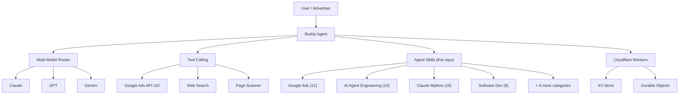

<p align="center">
  
</p>

<p align="center">
  <strong>AI 기반 Google Ads 관리를 위한 73개의 프로덕션 레디 스킬.</strong><br>
  <a href="https://googleadsagent.ai">googleadsagent.ai</a>의 <a href="https://googleadsagent.ai/tools/auditor/app">Buddy Agent</a>를 위해 제작되었습니다. Claude Code, Cursor, Codex, Gemini와 호환됩니다.
</p>

[English](README.md) | [Francais](README.fr.md) | [Espanol](README.es.md) | [中文](README.zh.md) | [Nederlands](README.nl.md) | [Русский](README.ru.md) | [한국어](README.ko.md)

---

## 스킬은 어떻게 생겼나요?

모든 스킬은 이름이 지정된 디렉토리 안의 단일 `SKILL.md` 파일입니다. 다음은 이 저장소의 실제 스킬입니다 — **Keyword Research** (`skills/google-ads/keyword-research/SKILL.md`):

```markdown
# Keyword Research

## 설명

Google Ads를 위한 체계적인 키워드 발굴, 확장 및 최적화.
시드 키워드에서 시맨틱 확장, 경쟁사 분석, 검색어 분석,
의도 기반 그룹화를 통해 키워드 유니버스를 구축합니다.
전환 확률에 따라 매치 타입을 할당하고,
계정, 캠페인, 광고 그룹 수준에서 제외 키워드 목록을 관리합니다.

## 사용 시점

- 사용자가 "키워드 리서치" 또는 "키워드 아이디어"를 요청할 때
- 사용자가 "키워드 확장" 또는 "새 키워드 찾기"를 원할 때
- 사용자가 "제외 키워드" 또는 "검색어 분석"을 언급할 때
- 사용자가 "매치 타입"(확장, 구문, 일치)에 대해 질문할 때
- 사용자가 비관련 검색어에 대한 "낭비 지출 절감"을 원할 때

## 구현

​```javascript
function assignMatchType(keyword) {
  if (keyword.conversionRate > 0.05 && keyword.volume < 1000)
    return 'EXACT';
  if (keyword.intent === 'transactional' && keyword.wordCount >= 3)
    return 'PHRASE';
  if (keyword.volume > 5000 && keyword.competitorPresence)
    return 'BROAD';
  return 'PHRASE';
}
​```

## 플랫폼 호환성

| 플랫폼      | 지원 여부 |
|-------------|-----------|
| Cursor      | ✅        |
| Claude Code | ✅        |
| Codex       | ✅        |
| Gemini CLI  | ✅        |

## 관련 스킬

- [Ad Copy Generation](../google-ads/ad-copy-generation/)
- [Competitor Analysis](../google-ads/competitor-analysis/)
- [Quality Score Optimization](../google-ads/quality-score-optimization/)
```

이것이 전체 형식입니다. 모든 스킬은 이 구조를 따릅니다:

<p align="center">
  
</p>

자세한 내용은 [전체 형식 사양](docs/skill-format.md)을 참조하세요.

---

## 빠른 시작

### 클론하여 바로 사용

```bash
git clone https://github.com/itallstartedwithaidea/agent-skills.git
cd agent-skills
```

### 모든 스킬 검증

```bash
npm run validate
```

### 카테고리별 스킬 수 확인

```bash
npm run count
```

클론 후 AI 에이전트를 `skills/` 디렉토리로 지정하세요. 각 `SKILL.md`는 독립적이며 필요 시 로드됩니다.

---

## 스킬 카탈로그

10개 카테고리에 걸친 73개 스킬:

| 카테고리 | 스킬 수 | 다루는 내용 |
|----------|---------|-------------|
| [Google Ads](skills/google-ads/) | 12 | 감사, 키워드, 광고 문구, 입찰, PMax, Shopping, 잠재고객, 전환, 예산, Quality Score, 리마케팅, 경쟁사 분석 |
| [AI Agent Engineering](skills/ai-agent-engineering/) | 10 | 지식 베이스 주입, 엔티티 메모리, 멀티 모델 라우팅, 선제적 인텔리전스, MCP 서버, 병렬 오케스트레이션 |
| [Claude Mythos](skills/claude-mythos/) | 10 | 프롬프트 아키텍처, 컨텍스트 엔지니어링, 도구 숙달, 자가 복구 에이전트, 검증 루프, 인지 스캐폴딩 |
| [Software Development](skills/software-dev/) | 8 | 코드 리뷰, TDD, 체계적 디버깅, git worktrees, 브레인스토밍, 서브에이전트 기반 개발 |
| [Scientific Research](skills/scientific-research/) | 8 | 데이터 분석, 머신 러닝, 생물정보학, 화학정보학, 지리공간 분석, 과학 논문 작성 |
| [Web Frontend](skills/web-frontend/) | 6 | React 모범 사례, React Native, view transitions, 엣지 배포, 컴포지션 패턴, 웹 디자인 |
| [Productivity](skills/productivity/) | 6 | 워크플로 오케스트레이션, 배치 처리, RAG 지식 베이스, AI 채팅 스튜디오, 로우코드 생성 |
| [Infrastructure](skills/infrastructure/) | 6 | Cloudflare Workers, CI/CD 파이프라인, 엣지 렌더링, 관측성, 서비스 디스커버리, 구성 관리 |
| [Security](skills/security/) | 4 | 에이전트 보안 스캐닝, CodeQL/Semgrep, 샌드박스 강화, 시크릿 보호 |
| [Media Creative](skills/media-creative/) | 3 | 웹 에셋 생성, 프로그래매틱 비디오, ML 모델 통합 |

---

## SKILL.md 형식

모든 스킬에는 다음 섹션이 필요합니다:

| 섹션 | 용도 |
|------|------|
| `# Title` | 사람이 읽을 수 있는 스킬 이름 |
| `## Description` | 2~5문장의 설명 (검색용으로 인덱싱됨) |
| `## Use When` | 트리거 시나리오 목록 |
| `## Implementation` | 코드 스니펫, 알고리즘, 절차 |
| `## Platform Compatibility` | Cursor / Claude Code / Codex / Gemini 지원 현황표 |
| `## Related Skills` | 관련 스킬 링크 |

선택 사항: `## Prerequisites`, `## Configuration`, `## Best Practices`, `## Limitations`, `## Keywords`

전체 사양: [docs/skill-format.md](docs/skill-format.md)

---

## 아키텍처

Buddy Agent는 사용자 의도 매칭을 기반으로 스킬을 온디맨드로 로드합니다:



전체 아키텍처 문서: [docs/architecture.md](docs/architecture.md)

---

## 플랫폼

[googleadsagent.ai](https://googleadsagent.ai)는 AI 네이티브 Google Ads 관리 플랫폼입니다. **Buddy Agent**는 그 핵심의 지능형 오케스트레이터입니다:

- **1,000개 패턴 지식 베이스** — TF-IDF 매칭을 통한 전문 Google Ads 패턴, 모든 AI 호출에 주입
- **멀티 모델 라우팅** — 세 가지 제공업체 모두에서 도구 호출이 가능한 Claude, GPT, Gemini
- **엔티티 메모리** — Cloudflare KV를 통해 세션 간 캠페인, 고충, 지표, 의사결정을 추적하는 영구 메모리
- **선제적 인텔리전스** — AI가 분석 중 자율적으로 웹을 검색하고 Google Ads 데이터를 다시 가져옴
- **Agent Skills 통합** — 이 저장소의 스킬을 온디맨드로 로드

---

## 기여하기

기여를 환영합니다. 가이드라인은 [CONTRIBUTING.md](CONTRIBUTING.md)를 참조하세요.

새로운 스킬을 추가하려면:

1. 적절한 `skills/` 카테고리 아래에 디렉토리를 생성합니다
2. [형식 사양](docs/skill-format.md)에 따라 `SKILL.md`를 추가합니다
3. `npm run validate`를 실행하여 검증을 통과하는지 확인합니다
4. Pull request를 제출합니다

---

## 크레딧

Agent Skills는 다음 오픈소스 프로젝트에서 영감을 받았습니다:

| 저장소 | 스타 수 | 배운 점 |
|--------|---------|---------|
| [obra/superpowers](https://github.com/obra/superpowers) | 148k | 에이전트 아키텍처, 자율 워크플로 설계 |
| [affaan-m/everything-claude-code](https://github.com/affaan-m/everything-claude-code) | 152k | Claude Code 모범 사례, 프롬프트 엔지니어링 |
| [vercel-labs/agent-skills](https://github.com/vercel-labs/agent-skills) | 25k | 스킬 형식 사양, 플러그인 아키텍처 |
| [K-Dense-AI/scientific-agent-skills](https://github.com/K-Dense-AI/scientific-agent-skills) | 18k | 스킬 검증을 위한 과학적 방법론 |

---

## 라이선스

MIT 라이선스. [LICENSE](LICENSE)를 참조하세요.

---

제작: [John Williams](https://itallstartedwithaidea.com) | 구동: [googleadsagent.ai](https://googleadsagent.ai)
