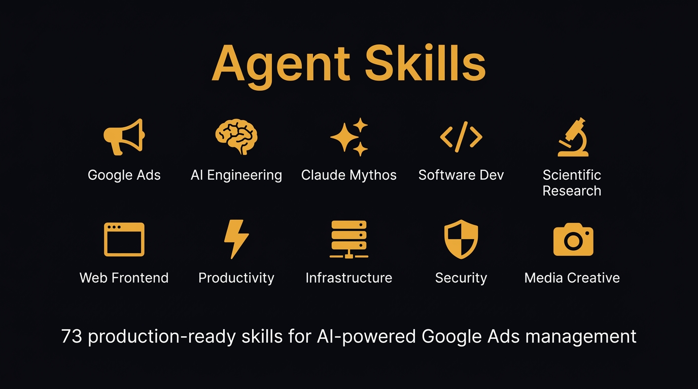
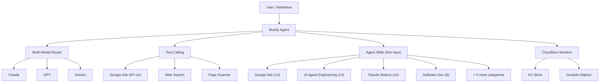

<p align="center">
  
</p>

<p align="center">
  <strong>73 production-ready skills for AI-powered Google Ads management.</strong><br>
  Built for <a href="https://googleadsagent.ai/tools/auditor/app">Buddy Agent</a> at <a href="https://googleadsagent.ai">googleadsagent.ai</a>. Works with Claude Code, Cursor, Codex, and Gemini.
</p>

[English](README.md) | [Francais](README.fr.md) | [Espanol](README.es.md) | [中文](README.zh.md) | [Nederlands](README.nl.md) | [Русский](README.ru.md) | [한국어](README.ko.md)

---

## What Does a Skill Look Like?

Every skill is a single `SKILL.md` file in a named directory. Here is a real skill from this repo — **Keyword Research** (`skills/google-ads/keyword-research/SKILL.md`):

```markdown
# Keyword Research

## Description

Systematic keyword discovery, expansion, and optimization for Google Ads.
Builds keyword universes from seed keywords through semantic expansion,
competitor mining, search term analysis, and intent-based grouping.
Assigns match types based on conversion probability and manages negative
keyword lists at account, campaign, and ad group levels.

## Use When

- User asks for "keyword research" or "keyword ideas"
- User wants to "expand keywords" or "find new keywords"
- User mentions "negative keywords" or "search term mining"
- User asks about "match types" (broad, phrase, exact)
- User wants to "reduce wasted spend" on irrelevant queries

## Implementation

​```javascript
function assignMatchType(keyword) {
  if (keyword.conversionRate > 0.05 && keyword.volume < 1000)
    return 'EXACT';
  if (keyword.intent === 'transactional' && keyword.wordCount >= 3)
    return 'PHRASE';
  if (keyword.volume > 5000 && keyword.competitorPresence)
    return 'BROAD';
  return 'PHRASE';
}
​```

## Platform Compatibility

| Platform    | Supported |
|-------------|-----------|
| Cursor      | ✅        |
| Claude Code | ✅        |
| Codex       | ✅        |
| Gemini CLI  | ✅        |

## Related Skills

- [Ad Copy Generation](../google-ads/ad-copy-generation/)
- [Competitor Analysis](../google-ads/competitor-analysis/)
- [Quality Score Optimization](../google-ads/quality-score-optimization/)
```

That is the complete format. Every skill follows this structure:

<p align="center">
  
</p>

See the [full format spec](docs/skill-format.md) for details.

---

## Quick Start

### Clone and use directly

```bash
git clone https://github.com/itallstartedwithaidea/agent-skills.git
cd agent-skills
```

### Validate all skills

```bash
npm run validate
```

### Count skills by category

```bash
npm run count
```

After cloning, point your AI agent at the `skills/` directory. Each `SKILL.md` is self-contained and loadable on demand.

---

## Skills Catalog

73 skills across 10 categories:

| Category | Skills | What It Covers |
|----------|--------|----------------|
| [Google Ads](skills/google-ads/) | 12 | Audits, keywords, ad copy, bidding, PMax, Shopping, audiences, conversions, budgets, Quality Score, remarketing, competitor analysis |
| [AI Agent Engineering](skills/ai-agent-engineering/) | 10 | Knowledge base injection, entity memory, multi-model routing, proactive intelligence, MCP servers, parallel orchestration |
| [Claude Mythos](skills/claude-mythos/) | 10 | Prompt architecture, context engineering, tool mastery, self-healing agents, verification loops, cognitive scaffolding |
| [Software Development](skills/software-dev/) | 8 | Code review, TDD, systematic debugging, git worktrees, brainstorming, subagent-driven development |
| [Scientific Research](skills/scientific-research/) | 8 | Data analysis, machine learning, bioinformatics, cheminformatics, geospatial analysis, scientific writing |
| [Web Frontend](skills/web-frontend/) | 6 | React best practices, React Native, view transitions, edge deployment, composition patterns, web design |
| [Productivity](skills/productivity/) | 6 | Workflow orchestration, batch processing, RAG knowledge bases, AI chat studio, low-code generation |
| [Infrastructure](skills/infrastructure/) | 6 | Cloudflare Workers, CI/CD pipelines, edge rendering, observability, service discovery, configuration management |
| [Security](skills/security/) | 4 | Agent security scanning, CodeQL/Semgrep, sandbox hardening, secret protection |
| [Media Creative](skills/media-creative/) | 3 | Web asset generation, programmatic video, ML model integration |

---

## SKILL.md Format

Every skill requires these sections:

| Section | Purpose |
|---------|---------|
| `# Title` | Human-readable skill name |
| `## Description` | 2-5 sentence explanation (indexed for search) |
| `## Use When` | Bullet list of trigger scenarios |
| `## Implementation` | Code snippets, algorithms, procedures |
| `## Platform Compatibility` | Cursor / Claude Code / Codex / Gemini support table |
| `## Related Skills` | Links to complementary skills |

Optional: `## Prerequisites`, `## Configuration`, `## Best Practices`, `## Limitations`, `## Keywords`

Full specification: [docs/skill-format.md](docs/skill-format.md)

---

## Architecture

Buddy Agent loads skills on demand based on user intent matching:



Full architecture documentation: [docs/architecture.md](docs/architecture.md)

---

## The Platform

[googleadsagent.ai](https://googleadsagent.ai) is the AI-native Google Ads management platform. **Buddy Agent** is the intelligent orchestrator at its core:

- **1,000-Pattern Knowledge Base** — Expert Google Ads patterns with TF-IDF matching, injected into every AI call
- **Multi-Model Routing** — Claude, GPT, and Gemini with tool calling on all three providers
- **Entity Memory** — Persistent memory tracking campaigns, pain points, metrics, and decisions across sessions via Cloudflare KV
- **Proactive Intelligence** — AI autonomously searches the web and re-pulls Google Ads data mid-analysis
- **Agent Skills Integration** — Loads skills from this repository on demand

---

## Contributing

We welcome contributions. See [CONTRIBUTING.md](CONTRIBUTING.md) for guidelines.

To add a new skill:

1. Create a directory under the appropriate `skills/` category
2. Add a `SKILL.md` following the [format spec](docs/skill-format.md)
3. Run `npm run validate` to confirm it passes
4. Submit a pull request

---

## Credits

Agent Skills was informed by these open-source projects:

| Repository | Stars | What We Learned |
|------------|-------|-----------------|
| [obra/superpowers](https://github.com/obra/superpowers) | 148k | Agent architecture, autonomous workflow design |
| [affaan-m/everything-claude-code](https://github.com/affaan-m/everything-claude-code) | 152k | Claude Code best practices, prompt engineering |
| [vercel-labs/agent-skills](https://github.com/vercel-labs/agent-skills) | 25k | Skills format specification, plugin architecture |
| [K-Dense-AI/scientific-agent-skills](https://github.com/K-Dense-AI/scientific-agent-skills) | 18k | Scientific methodology for skill validation |

---

## License

MIT License. See [LICENSE](LICENSE).

---

Built by [John Williams](https://itallstartedwithaidea.com) | Powered by [googleadsagent.ai](https://googleadsagent.ai)
