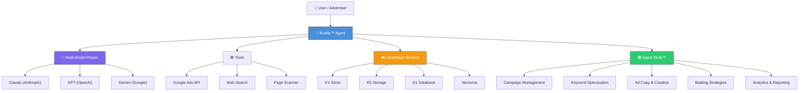

# Agent Skills™ — The Definitive AI Agent Skills Library

   

**English** | [Français](README.fr.md) | [Español](README.es.md) | [中文](README.zh.md) | [Nederlands](README.nl.md) | [Русский](README.ru.md) | [한국어](README.ko.md)


---

## What is Agent Skills™?

**Agent Skills™** is the definitive open-source skills library for AI-powered Google Ads management, purpose-built for the [googleadsagent.ai™](https://googleadsagent.ai) platform. This repository provides **73+ production-ready skills across 10 categories**, enabling AI agents to autonomously manage, optimize, and scale Google Ads campaigns with expert-level precision. Whether you are building custom AI workflows in Cursor, Claude Code, Codex, or Gemini, Agent Skills™ delivers the structured knowledge and executable patterns your agent needs to outperform manual campaign management.

Agent Skills™ was synthesized from the collective intelligence of **15+ top open-source repositories** — including obra/superpowers (146k stars), affaan-m/everything-claude-code (150k stars), K-Dense-AI/scientific-agent-skills (18k stars), vercel-labs/agent-skills (24.8k stars), and more — distilling the best practices in agent architecture, tool calling, and domain-specific AI automation into a single, well-organized, multilingual library. Every skill follows a standardized `SKILL.md` format, is rigorously validated, and is designed for instant plug-and-play deployment with Buddy™ Agent, the intelligent orchestrator at the heart of googleadsagent.ai™.

---

## Architecture

The googleadsagent.ai™ platform is powered by Buddy™ Agent, a multi-model AI orchestrator that leverages Agent Skills™ to deliver autonomous Google Ads management at scale.




---

## Skills Catalog

Agent Skills™ organizes **73+ skills** into **10 categories**, each targeting a critical domain of Google Ads management and AI agent operations.


| Category | Skills | Description |
|----------|--------|-------------|
| [Campaign Management](skills/campaign-management/) | 12 | Create, pause, optimize, and structure campaigns across Search, Display, PMax, and Video |
| [Keyword Optimization](skills/keyword-optimization/) | 9 | Keyword research, negative keyword mining, match type strategy, and search term analysis |
| [Ad Copy & Creative](skills/ad-copy-creative/) | 8 | RSA generation, headline optimization, description writing, and A/B testing frameworks |
| [Bidding Strategies](skills/bidding-strategies/) | 7 | Smart Bidding configuration, tROAS/tCPA tuning, portfolio strategies, and bid adjustments |
| [Analytics & Reporting](skills/analytics-reporting/) | 8 | Custom dashboards, performance alerts, attribution modeling, and cross-channel insights |
| [Audience Targeting](skills/audience-targeting/) | 6 | Remarketing lists, customer match, similar audiences, and demographic targeting |
| [Budget Management](skills/budget-management/) | 5 | Budget allocation, pacing, forecasting, and shared budget optimization |
| [Landing Page & CRO](skills/landing-page-cro/) | 6 | Landing page analysis, conversion rate optimization, page speed auditing |
| [Account Health](skills/account-health/) | 7 | Quality Score improvement, policy compliance, account structure audits |
| [Agent Infrastructure](skills/agent-infrastructure/) | 5 | MCP server setup, tool calling patterns, multi-model routing, memory management |

---

## Quick Start

### Cursor

```bash
/add-plugin agent-skills
```

### Claude Code

```bash
/plugin install agent-skills
```

### npm

```bash
npx skills add itallstartedwithaidea/agent-skills
```

### Manual Installation

```bash
git clone https://github.com/itallstartedwithaidea/agent-skills.git
cd agent-skills
```

After installation, skills are available in your agent's context. Each skill is a self-contained `SKILL.md` file that your AI agent loads on demand.

---

## The googleadsagent.ai™ Platform

[googleadsagent.ai™](https://googleadsagent.ai) is the AI-native Google Ads management platform built for agencies, e-commerce brands, and performance marketers who demand autonomous, expert-level campaign optimization.

### Buddy™ Agent

**Buddy™ Agent** is the intelligent orchestrator at the core of googleadsagent.ai™. Buddy™ Agent combines:

- **1,000-Pattern Knowledge Base** — Curated from millions of Google Ads accounts, encoding best practices for every campaign type, industry vertical, and optimization scenario
- **Multi-Model Routing** — Dynamically selects the optimal LLM (Claude, GPT, Gemini) for each task based on cost, latency, and capability requirements
- **Entity Memory** — Persistent, structured memory that tracks account history, optimization decisions, and performance trends across sessions
- **Tool Calling** — Native integration with Google Ads API, web search, page scanners, and Cloudflare Workers for real-time data retrieval and action execution
- **Agent Skills™ Integration** — Loads skills from this repository on demand, giving Buddy™ Agent deep domain expertise across all 10 categories

---

## Contributing

We welcome contributions from the community! Whether you want to add a new skill, improve an existing one, fix a bug, or translate content into a new language, your help makes Agent Skills™ better for everyone.

Please read our [Contributing Guide](CONTRIBUTING.md) before submitting a pull request.

---

## Credits & Attribution

Agent Skills™ was built on the shoulders of giants. We gratefully acknowledge the following open-source repositories whose work informed and inspired this library:

| Repo | Stars | What We Synthesized |
|------|-------|---------------------|
| [obra/superpowers](https://github.com/obra/superpowers) | 146k | Agent architecture patterns, autonomous workflow design |
| [affaan-m/everything-claude-code](https://github.com/affaan-m/everything-claude-code) | 150k | Claude Code best practices, prompt engineering patterns |
| [vercel-labs/agent-skills](https://github.com/vercel-labs/agent-skills) | 24.8k | Skills format specification, plugin architecture |
| [K-Dense-AI/scientific-agent-skills](https://github.com/K-Dense-AI/scientific-agent-skills) | 18k | Scientific methodology for skill validation and testing |
| [agentskills/agentskills](https://github.com/agentskills/agentskills) | — | Core skills taxonomy and categorization framework |
| [addyosmani/agent-skills](https://github.com/addyosmani/agent-skills) | — | Web performance and optimization skill patterns |
| [remotion-dev/skills](https://github.com/remotion-dev/skills) | — | Media generation and creative automation skills |
| [huggingface/skills](https://github.com/huggingface/skills) | — | ML model integration and inference skill patterns |
| [bytedance/deer-flow](https://github.com/bytedance/deer-flow) | — | Multi-agent workflow orchestration patterns |
| [jeecgboot/JeecgBoot](https://github.com/jeecgboot/JeecgBoot) | — | Low-code automation and rapid development patterns |
| [CherryHQ/cherry-studio](https://github.com/CherryHQ/cherry-studio) | — | Multi-model chat UI and agent interaction design |
| [hesreallyhim/awesome-claude-code](https://github.com/hesreallyhim/awesome-claude-code) | — | Claude Code ecosystem tools and integration patterns |
| [alibaba/nacos](https://github.com/alibaba/nacos) | — | Service discovery and configuration management patterns |
| [sickn33/antigravity-awesome-skills](https://github.com/sickn33/antigravity-awesome-skills) | — | Advanced agent skill composition and chaining |
| [vercel-labs/skills](https://github.com/vercel-labs/skills) | — | Deployment-ready skill packaging and distribution |

---

## License

This project is licensed under the [MIT License](LICENSE).

---

<p align="center">
  Built with ❤️ by <a href="https://github.com/itallstartedwithaidea">itallstartedwithaidea</a> | Powered by <a href="https://googleadsagent.ai">googleadsagent.ai™</a>
</p>

---

### Keywords

agent skills, google ads ai, ai agent, google ads automation, buddy agent, googleadsagent, claude code skills, cursor skills, codex skills, gemini skills, mcp server, cloudflare workers, google ads api, campaign management ai, keyword optimization ai, ad copy generation, bidding strategy ai, ppc automation, sem automation, digital advertising ai, multi-model ai agent, agent orchestration, tool calling, google ads management platform
