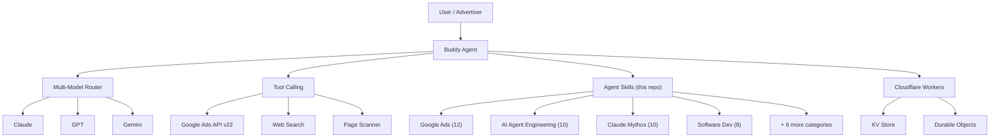

<p align="center">
  
</p>

<p align="center">
  <strong>73 productieklare skills voor AI-gestuurd Google Ads-beheer.</strong><br>
  Gebouwd voor <a href="https://googleadsagent.ai/tools/auditor/app">Buddy Agent</a> op <a href="https://googleadsagent.ai">googleadsagent.ai</a>. Werkt met Claude Code, Cursor, Codex en Gemini.
</p>

[English](README.md) | [Francais](README.fr.md) | [Espanol](README.es.md) | [中文](README.zh.md) | [Nederlands](README.nl.md) | [Русский](README.ru.md) | [한국어](README.ko.md)

---

## Hoe ziet een Skill eruit?

Elke skill is één `SKILL.md`-bestand in een benoemde map. Hier is een echte skill uit deze repo — **Keyword Research** (`skills/google-ads/keyword-research/SKILL.md`):

```markdown
# Keyword Research

## Beschrijving

Systematisch zoekwoorden ontdekken, uitbreiden en optimaliseren voor Google Ads.
Bouwt zoekwoorduniversums op vanuit zaadzoekwoorden via semantische uitbreiding,
concurrentanalyse, zoektermanalyse en intentiegebaseerde groepering.
Wijst zoektypen toe op basis van conversiewaarschijnlijkheid en beheert
uitsluitingszoekwoordenlijsten op account-, campagne- en advertentiegroepniveau.

## Wanneer te gebruiken

- Gebruiker vraagt om "zoekwoordonderzoek" of "zoekwoordideeën"
- Gebruiker wil "zoekwoorden uitbreiden" of "nieuwe zoekwoorden vinden"
- Gebruiker noemt "uitsluitingszoekwoorden" of "zoektermanalyse"
- Gebruiker vraagt over "zoektypen" (breed, woordgroep, exact)
- Gebruiker wil "verspilde uitgaven verminderen" aan irrelevante zoekopdrachten

## Implementatie

​```javascript
function assignMatchType(keyword) {
  if (keyword.conversionRate > 0.05 && keyword.volume < 1000)
    return 'EXACT';
  if (keyword.intent === 'transactional' && keyword.wordCount >= 3)
    return 'PHRASE';
  if (keyword.volume > 5000 && keyword.competitorPresence)
    return 'BROAD';
  return 'PHRASE';
}
​```

## Platformcompatibiliteit

| Platform    | Ondersteund |
|-------------|-------------|
| Cursor      | ✅          |
| Claude Code | ✅          |
| Codex       | ✅          |
| Gemini CLI  | ✅          |

## Gerelateerde Skills

- [Ad Copy Generation](../google-ads/ad-copy-generation/)
- [Competitor Analysis](../google-ads/competitor-analysis/)
- [Quality Score Optimization](../google-ads/quality-score-optimization/)
```

Dat is het volledige formaat. Elke skill volgt deze structuur:

<p align="center">
  
</p>

Zie de [volledige formaatspecificatie](docs/skill-format.md) voor details.

---

## Snel aan de slag

### Klonen en direct gebruiken

```bash
git clone https://github.com/itallstartedwithaidea/agent-skills.git
cd agent-skills
```

### Alle skills valideren

```bash
npm run validate
```

### Skills tellen per categorie

```bash
npm run count
```

Na het klonen wijs je je AI-agent naar de `skills/`-map. Elk `SKILL.md`-bestand is op zichzelf staand en kan op aanvraag worden geladen.

---

## Skillscatalogus

73 skills verdeeld over 10 categorieën:

| Categorie | Skills | Wat het omvat |
|-----------|--------|---------------|
| [Google Ads](skills/google-ads/) | 12 | Audits, zoekwoorden, advertentieteksten, biedingen, PMax, Shopping, doelgroepen, conversies, budgetten, Quality Score, remarketing, concurrentieanalyse |
| [AI Agent Engineering](skills/ai-agent-engineering/) | 10 | Kennisbank-injectie, entiteitsgeheugen, multi-model routing, proactieve intelligentie, MCP-servers, parallelle orkestratie |
| [Claude Mythos](skills/claude-mythos/) | 10 | Promptarchitectuur, context-engineering, toolbeheersing, zelfherstellende agents, verificatielussen, cognitieve ondersteuning |
| [Software Development](skills/software-dev/) | 8 | Codebeoordeling, TDD, systematisch debuggen, git worktrees, brainstormen, subagent-gestuurde ontwikkeling |
| [Scientific Research](skills/scientific-research/) | 8 | Data-analyse, machine learning, bio-informatica, cheminformatica, geospatiale analyse, wetenschappelijk schrijven |
| [Web Frontend](skills/web-frontend/) | 6 | React best practices, React Native, view transitions, edge-deployment, compositiepatronen, webdesign |
| [Productivity](skills/productivity/) | 6 | Workfloworkestratie, batchverwerking, RAG-kennisbanken, AI-chatstudio, low-code-generatie |
| [Infrastructure](skills/infrastructure/) | 6 | Cloudflare Workers, CI/CD-pipelines, edge-rendering, observability, service discovery, configuratiebeheer |
| [Security](skills/security/) | 4 | Agent-beveiligingsscanning, CodeQL/Semgrep, sandbox-hardening, secretbescherming |
| [Media Creative](skills/media-creative/) | 3 | Webassetgeneratie, programmatische video, ML-modelintegratie |

---

## SKILL.md-formaat

Elke skill vereist deze secties:

| Sectie | Doel |
|--------|------|
| `# Title` | Leesbare skillnaam |
| `## Description` | Uitleg van 2-5 zinnen (geïndexeerd voor zoeken) |
| `## Use When` | Opsomming van triggerscenario's |
| `## Implementation` | Codefragmenten, algoritmen, procedures |
| `## Platform Compatibility` | Ondersteuningsoverzicht voor Cursor / Claude Code / Codex / Gemini |
| `## Related Skills` | Links naar aanvullende skills |

Optioneel: `## Prerequisites`, `## Configuration`, `## Best Practices`, `## Limitations`, `## Keywords`

Volledige specificatie: [docs/skill-format.md](docs/skill-format.md)

---

## Architectuur

Buddy Agent laadt skills op aanvraag op basis van intentieherkenning:



Volledige architectuurdocumentatie: [docs/architecture.md](docs/architecture.md)

---

## Het Platform

[googleadsagent.ai](https://googleadsagent.ai) is het AI-native platform voor Google Ads-beheer. **Buddy Agent** is de intelligente orkestrator in de kern:

- **1.000-Patroon Kennisbank** — Deskundige Google Ads-patronen met TF-IDF-matching, geïnjecteerd in elke AI-aanroep
- **Multi-Model Routing** — Claude, GPT en Gemini met tool calling op alle drie de providers
- **Entiteitsgeheugen** — Persistent geheugen dat campagnes, pijnpunten, statistieken en beslissingen bijhoudt over sessies heen via Cloudflare KV
- **Proactieve Intelligentie** — AI doorzoekt autonoom het web en haalt Google Ads-data opnieuw op tijdens analyses
- **Agent Skills-integratie** — Laadt skills uit deze repository op aanvraag

---

## Bijdragen

Bijdragen zijn welkom. Zie [CONTRIBUTING.md](CONTRIBUTING.md) voor richtlijnen.

Om een nieuwe skill toe te voegen:

1. Maak een map aan onder de juiste `skills/`-categorie
2. Voeg een `SKILL.md` toe volgens de [formaatspecificatie](docs/skill-format.md)
3. Voer `npm run validate` uit om te bevestigen dat het slaagt
4. Dien een pull request in

---

## Credits

Agent Skills is geïnspireerd door deze open-sourceprojecten:

| Repository | Sterren | Wat we ervan leerden |
|------------|---------|----------------------|
| [obra/superpowers](https://github.com/obra/superpowers) | 148k | Agent-architectuur, autonoom workflowontwerp |
| [affaan-m/everything-claude-code](https://github.com/affaan-m/everything-claude-code) | 152k | Claude Code best practices, prompt-engineering |
| [vercel-labs/agent-skills](https://github.com/vercel-labs/agent-skills) | 25k | Skillsformaatspecificatie, plugin-architectuur |
| [K-Dense-AI/scientific-agent-skills](https://github.com/K-Dense-AI/scientific-agent-skills) | 18k | Wetenschappelijke methodologie voor skillvalidatie |

---

## Licentie

MIT-licentie. Zie [LICENSE](LICENSE).

---

Gebouwd door [John Williams](https://itallstartedwithaidea.com) | Mogelijk gemaakt door [googleadsagent.ai](https://googleadsagent.ai)
