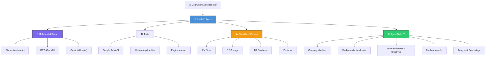

# Agent Skills™ — De definitieve AI Agent Skills-bibliotheek

   

[English](README.md) | [Français](README.fr.md) | [Español](README.es.md) | [中文](README.zh.md) | **Nederlands** | [Русский](README.ru.md) | [한국어](README.ko.md)


---

## Wat is Agent Skills™?

**Agent Skills™** is de definitieve open-source skillsbibliotheek voor AI-aangedreven Google Ads-beheer, speciaal gebouwd voor het [googleadsagent.ai™](https://googleadsagent.ai) platform. Deze repository biedt **73+ productieklare skills verdeeld over 10 categorieën**, waarmee AI-agenten autonoom Google Ads-campagnes kunnen beheren, optimaliseren en opschalen met expertise op expertniveau. Of u nu aangepaste AI-workflows bouwt in Cursor, Claude Code, Codex of Gemini, Agent Skills™ levert de gestructureerde kennis en uitvoerbare patronen die uw agent nodig heeft om handmatig campagnebeheer te overtreffen.

Agent Skills™ is gesynthetiseerd uit de collectieve intelligentie van **15+ toonaangevende open-source repositories** — waaronder obra/superpowers (146k sterren), affaan-m/everything-claude-code (150k sterren), K-Dense-AI/scientific-agent-skills (18k sterren), vercel-labs/agent-skills (24,8k sterren) en meer — waarbij de beste praktijken in agentarchitectuur, tool-aanroepen en domeinspecifieke AI-automatisering zijn gedistilleerd tot één enkele, goed georganiseerde, meertalige bibliotheek. Elke skill volgt een gestandaardiseerd `SKILL.md`-formaat, is rigoureus gevalideerd en is ontworpen voor directe plug-and-play-implementatie met Buddy™ Agent, de intelligente orchestrator in het hart van googleadsagent.ai™.

---

## Architectuur

Het googleadsagent.ai™ platform wordt aangedreven door Buddy™ Agent, een multi-model AI-orchestrator die Agent Skills™ benut om autonoom Google Ads-beheer op schaal te leveren.




---

## Skills Catalogus

Agent Skills™ organiseert **73+ skills** in **10 categorieën**, elk gericht op een kritiek domein van Google Ads-beheer en AI-agentoperaties.


| Categorie | Skills | Beschrijving |
|-----------|--------|--------------|
| [Campagnebeheer](skills/campaign-management/) | 12 | Campagnes aanmaken, pauzeren, optimaliseren en structureren voor Zoeken, Display, PMax en Video |
| [Zoekwoordoptimalisatie](skills/keyword-optimization/) | 9 | Zoekwoordonderzoek, uitsluitingszoekwoorden, match type-strategie en zoektermenanalyse |
| [Advertentietekst & Creatives](skills/ad-copy-creative/) | 8 | RSA-generatie, koptekstoptimalisatie, beschrijvingen schrijven en A/B-testframeworks |
| [Biedstrategieën](skills/bidding-strategies/) | 7 | Smart Bidding-configuratie, tROAS/tCPA-afstemming, portfoliostrategieën en biedaanpassingen |
| [Analyse & Rapportage](skills/analytics-reporting/) | 8 | Aangepaste dashboards, prestatiewaarschuwingen, attributiemodellering en cross-channel inzichten |
| [Doelgroeptargeting](skills/audience-targeting/) | 6 | Remarketinglijsten, Customer Match, vergelijkbare doelgroepen en demografische targeting |
| [Budgetbeheer](skills/budget-management/) | 5 | Budgetallocatie, bestedings­tempo, prognoses en optimalisatie van gedeelde budgetten |
| [Landingspagina & CRO](skills/landing-page-cro/) | 6 | Landingspagina-analyse, conversieratio-optimalisatie, paginasnelheidsaudit |
| [Accountgezondheid](skills/account-health/) | 7 | Quality Score-verbetering, beleidsnaleving, accountstructuuraudits |
| [Agent­infrastructuur](skills/agent-infrastructure/) | 5 | MCP-serverconfiguratie, tool-aanroeppatronen, multi-model routing, geheugenbeheer |

---

## Snel Starten

### Cursor

```bash
/add-plugin agent-skills
```

### Claude Code

```bash
/plugin install agent-skills
```

### npm

```bash
npx skills add itallstartedwithaidea/agent-skills
```

### Handmatige Installatie

```bash
git clone https://github.com/itallstartedwithaidea/agent-skills.git
cd agent-skills
```

Na installatie zijn de skills beschikbaar in de context van uw agent. Elke skill is een zelfstandig `SKILL.md`-bestand dat uw AI-agent op aanvraag laadt.

---

## Het googleadsagent.ai™ Platform

[googleadsagent.ai™](https://googleadsagent.ai) is het AI-native Google Ads-beheerplatform gebouwd voor bureaus, e-commercemerken en performance marketeers die autonome, expert-level campagneoptimalisatie eisen.

### Buddy™ Agent

**Buddy™ Agent** is de intelligente orchestrator in de kern van googleadsagent.ai™. Buddy™ Agent combineert:

- **1.000-Patronen Kennisbank** — Samengesteld uit miljoenen Google Ads-accounts, met best practices voor elk campagnetype, elke brancheverticaal en elk optimalisatiescenario
- **Multi-Model Routing** — Selecteert dynamisch het optimale LLM (Claude, GPT, Gemini) voor elke taak op basis van kosten, latentie en capaciteitsvereisten
- **Entity Memory** — Persistent, gestructureerd geheugen dat accountgeschiedenis, optimalisatiebeslissingen en prestatietrends over sessies heen bijhoudt
- **Tool Calling** — Natieve integratie met Google Ads API, webzoekopdrachten, paginascanners en Cloudflare Workers voor real-time data-ophaling en actie-uitvoering
- **Agent Skills™ Integratie** — Laadt skills uit deze repository op aanvraag, waardoor Buddy™ Agent diepe domeinexpertise krijgt over alle 10 categorieën

---

## Bijdragen

We verwelkomen bijdragen van de gemeenschap! Of u nu een nieuwe skill wilt toevoegen, een bestaande wilt verbeteren, een bug wilt oplossen of inhoud naar een nieuwe taal wilt vertalen, uw hulp maakt Agent Skills™ beter voor iedereen.

Lees onze [Bijdragegids](CONTRIBUTING.md) voordat u een pull request indient.

---

## Credits & Bronvermelding

Agent Skills™ is gebouwd op de schouders van reuzen. We bedanken met dankbaarheid de volgende open-source repositories wiens werk deze bibliotheek heeft geïnformeerd en geïnspireerd:

| Repository | Sterren | Wat we hebben gesynthetiseerd |
|------------|---------|-------------------------------|
| [obra/superpowers](https://github.com/obra/superpowers) | 146k | Agent-architectuurpatronen, autonoom workflowontwerp |
| [affaan-m/everything-claude-code](https://github.com/affaan-m/everything-claude-code) | 150k | Claude Code best practices, prompt engineering-patronen |
| [vercel-labs/agent-skills](https://github.com/vercel-labs/agent-skills) | 24,8k | Skills-formaatspecificatie, plugin-architectuur |
| [K-Dense-AI/scientific-agent-skills](https://github.com/K-Dense-AI/scientific-agent-skills) | 18k | Wetenschappelijke methodologie voor skillvalidatie en -testen |
| [agentskills/agentskills](https://github.com/agentskills/agentskills) | — | Kerntaxonomie en categorisatiekader voor skills |
| [addyosmani/agent-skills](https://github.com/addyosmani/agent-skills) | — | Webprestatie- en optimalisatieskillpatronen |
| [remotion-dev/skills](https://github.com/remotion-dev/skills) | — | Mediageneratie en creatieve automatiseringsskills |
| [huggingface/skills](https://github.com/huggingface/skills) | — | ML-modelintegratie en inferentieskillpatronen |
| [bytedance/deer-flow](https://github.com/bytedance/deer-flow) | — | Multi-agent workflow-orchestratiepatronen |
| [jeecgboot/JeecgBoot](https://github.com/jeecgboot/JeecgBoot) | — | Low-code automatisering en snelle ontwikkelingspatronen |
| [CherryHQ/cherry-studio](https://github.com/CherryHQ/cherry-studio) | — | Multi-model chat-UI en agent-interactieontwerp |
| [hesreallyhim/awesome-claude-code](https://github.com/hesreallyhim/awesome-claude-code) | — | Claude Code ecosysteemtools en integratiepatronen |
| [alibaba/nacos](https://github.com/alibaba/nacos) | — | Service discovery en configuratiebeheerpatronen |
| [sickn33/antigravity-awesome-skills](https://github.com/sickn33/antigravity-awesome-skills) | — | Geavanceerde agent-skillcompositie en -chaining |
| [vercel-labs/skills](https://github.com/vercel-labs/skills) | — | Deploymentklare skillverpakking en -distributie |

---

## Licentie

Dit project is gelicentieerd onder de [MIT-licentie](LICENSE).

---

<p align="center">
  Gebouwd met ❤️ door <a href="https://github.com/itallstartedwithaidea">itallstartedwithaidea</a> | Aangedreven door <a href="https://googleadsagent.ai">googleadsagent.ai™</a>
</p>

---

### Trefwoorden

agent skills, google ads ai, ai-agent, google ads automatisering, buddy agent, googleadsagent, claude code skills, cursor skills, codex skills, gemini skills, mcp server, cloudflare workers, google ads api, campagnebeheer ai, zoekwoordoptimalisatie ai, advertentietekstgeneratie, biedstrategie ai, ppc automatisering, sem automatisering, digitale reclame ai, multi-model ai-agent, agentorchestratie, tool calling, google ads beheerplatform
