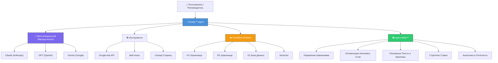

# Agent Skills™ — Эталонная библиотека навыков ИИ-агентов

   

[English](README.md) | [Français](README.fr.md) | [Español](README.es.md) | [中文](README.zh.md) | [Nederlands](README.nl.md) | **Русский** | [한국어](README.ko.md)


---

## Что такое Agent Skills™?

**Agent Skills™** — это эталонная библиотека навыков с открытым исходным кодом для управления Google Ads на основе искусственного интеллекта, специально разработанная для платформы [googleadsagent.ai™](https://googleadsagent.ai). Этот репозиторий предоставляет **более 73 готовых к производству навыков в 10 категориях**, позволяя ИИ-агентам автономно управлять, оптимизировать и масштабировать рекламные кампании Google Ads с экспертной точностью. Независимо от того, создаёте ли вы пользовательские ИИ-рабочие процессы в Cursor, Claude Code, Codex или Gemini, Agent Skills™ предоставляет вашему агенту структурированные знания и исполняемые шаблоны, необходимые для превосходства над ручным управлением кампаниями.

Agent Skills™ был синтезирован из коллективного интеллекта **более 15 ведущих репозиториев с открытым исходным кодом** — включая obra/superpowers (146 тыс. звёзд), affaan-m/everything-claude-code (150 тыс. звёзд), K-Dense-AI/scientific-agent-skills (18 тыс. звёзд), vercel-labs/agent-skills (24,8 тыс. звёзд) и другие — объединяя лучшие практики архитектуры агентов, вызовов инструментов и доменной ИИ-автоматизации в единую, хорошо организованную, многоязычную библиотеку. Каждый навык следует стандартизированному формату `SKILL.md`, тщательно валидирован и предназначен для мгновенного развёртывания с Buddy™ Agent — интеллектуальным оркестратором в основе googleadsagent.ai™.

---

## Архитектура

Платформа googleadsagent.ai™ работает на основе Buddy™ Agent — мультимодельного ИИ-оркестратора, который использует Agent Skills™ для обеспечения автономного управления Google Ads в масштабе.




---

## Каталог Навыков

Agent Skills™ организует **более 73 навыков** в **10 категорий**, каждая из которых охватывает критически важную область управления Google Ads и операций ИИ-агентов.


| Категория | Навыки | Описание |
|-----------|--------|----------|
| [Управление Кампаниями](skills/campaign-management/) | 12 | Создание, приостановка, оптимизация и структурирование кампаний Поиска, КМС, PMax и Видео |
| [Оптимизация Ключевых Слов](skills/keyword-optimization/) | 9 | Исследование ключевых слов, минус-слова, стратегия типов соответствия и анализ поисковых запросов |
| [Рекламные Тексты и Креативы](skills/ad-copy-creative/) | 8 | Генерация RSA, оптимизация заголовков, написание описаний и фреймворки A/B-тестирования |
| [Стратегии Ставок](skills/bidding-strategies/) | 7 | Настройка Smart Bidding, оптимизация tROAS/tCPA, портфельные стратегии и корректировки ставок |
| [Аналитика и Отчётность](skills/analytics-reporting/) | 8 | Пользовательские панели, оповещения о производительности, моделирование атрибуции и кросс-канальные инсайты |
| [Таргетинг Аудиторий](skills/audience-targeting/) | 6 | Списки ремаркетинга, Customer Match, похожие аудитории и демографический таргетинг |
| [Управление Бюджетом](skills/budget-management/) | 5 | Распределение бюджета, темп расхода, прогнозирование и оптимизация общих бюджетов |
| [Целевые Страницы и CRO](skills/landing-page-cro/) | 6 | Анализ целевых страниц, оптимизация коэффициента конверсии, аудит скорости страниц |
| [Здоровье Аккаунта](skills/account-health/) | 7 | Улучшение Quality Score, соответствие политикам, аудиты структуры аккаунта |
| [Инфраструктура Агентов](skills/agent-infrastructure/) | 5 | Настройка MCP-сервера, шаблоны вызовов инструментов, мультимодельная маршрутизация, управление памятью |

---

## Быстрый Старт

### Cursor

```bash
/add-plugin agent-skills
```

### Claude Code

```bash
/plugin install agent-skills
```

### npm

```bash
npx skills add itallstartedwithaidea/agent-skills
```

### Ручная Установка

```bash
git clone https://github.com/itallstartedwithaidea/agent-skills.git
cd agent-skills
```

После установки навыки доступны в контексте вашего агента. Каждый навык — это автономный файл `SKILL.md`, который ваш ИИ-агент загружает по запросу.

---

## Платформа googleadsagent.ai™

[googleadsagent.ai™](https://googleadsagent.ai) — это ИИ-нативная платформа управления Google Ads, созданная для агентств, e-commerce брендов и маркетологов, ориентированных на результат, которые требуют автономной оптимизации кампаний экспертного уровня.

### Buddy™ Agent

**Buddy™ Agent** — это интеллектуальный оркестратор в основе googleadsagent.ai™. Buddy™ Agent объединяет:

- **База Знаний из 1 000 Паттернов** — Составлена на основе миллионов аккаунтов Google Ads, кодирующая лучшие практики для каждого типа кампании, отраслевой вертикали и сценария оптимизации
- **Мультимодельная Маршрутизация** — Динамически выбирает оптимальную LLM (Claude, GPT, Gemini) для каждой задачи на основе стоимости, задержки и требований к возможностям
- **Память Сущностей** — Постоянная, структурированная память, отслеживающая историю аккаунта, решения по оптимизации и тренды производительности между сессиями
- **Вызовы Инструментов** — Нативная интеграция с Google Ads API, веб-поиском, сканерами страниц и Cloudflare Workers для извлечения данных и выполнения действий в реальном времени
- **Интеграция Agent Skills™** — Загружает навыки из этого репозитория по запросу, предоставляя Buddy™ Agent глубокую экспертизу во всех 10 категориях

---

## Участие

Мы приветствуем вклад сообщества! Хотите ли вы добавить новый навык, улучшить существующий, исправить ошибку или перевести контент на новый язык — ваша помощь делает Agent Skills™ лучше для всех.

Пожалуйста, прочитайте наше [Руководство по Участию](CONTRIBUTING.md) перед отправкой pull request.

---

## Благодарности и Атрибуция

Agent Skills™ был создан на плечах гигантов. Мы с благодарностью отмечаем следующие репозитории с открытым исходным кодом, чья работа информировала и вдохновила эту библиотеку:

| Репозиторий | Звёзды | Что мы синтезировали |
|-------------|--------|----------------------|
| [obra/superpowers](https://github.com/obra/superpowers) | 146 тыс. | Паттерны архитектуры агентов, проектирование автономных рабочих процессов |
| [affaan-m/everything-claude-code](https://github.com/affaan-m/everything-claude-code) | 150 тыс. | Лучшие практики Claude Code, паттерны промпт-инженерии |
| [vercel-labs/agent-skills](https://github.com/vercel-labs/agent-skills) | 24,8 тыс. | Спецификация формата навыков, архитектура плагинов |
| [K-Dense-AI/scientific-agent-skills](https://github.com/K-Dense-AI/scientific-agent-skills) | 18 тыс. | Научная методология валидации и тестирования навыков |
| [agentskills/agentskills](https://github.com/agentskills/agentskills) | — | Таксономия и фреймворк категоризации навыков |
| [addyosmani/agent-skills](https://github.com/addyosmani/agent-skills) | — | Паттерны навыков веб-производительности и оптимизации |
| [remotion-dev/skills](https://github.com/remotion-dev/skills) | — | Навыки генерации медиа и креативной автоматизации |
| [huggingface/skills](https://github.com/huggingface/skills) | — | Интеграция ML-моделей и паттерны навыков инференса |
| [bytedance/deer-flow](https://github.com/bytedance/deer-flow) | — | Паттерны оркестрации мультиагентных рабочих процессов |
| [jeecgboot/JeecgBoot](https://github.com/jeecgboot/JeecgBoot) | — | Low-code автоматизация и паттерны быстрой разработки |
| [CherryHQ/cherry-studio](https://github.com/CherryHQ/cherry-studio) | — | Мультимодельный чат-интерфейс и дизайн взаимодействия с агентами |
| [hesreallyhim/awesome-claude-code](https://github.com/hesreallyhim/awesome-claude-code) | — | Инструменты экосистемы Claude Code и паттерны интеграции |
| [alibaba/nacos](https://github.com/alibaba/nacos) | — | Паттерны обнаружения сервисов и управления конфигурацией |
| [sickn33/antigravity-awesome-skills](https://github.com/sickn33/antigravity-awesome-skills) | — | Продвинутая композиция и цепочки навыков агентов |
| [vercel-labs/skills](https://github.com/vercel-labs/skills) | — | Упаковка и распространение навыков, готовых к развёртыванию |

---

## Лицензия

Этот проект лицензирован под [лицензией MIT](LICENSE).

---

<p align="center">
  Создано с ❤️ командой <a href="https://github.com/itallstartedwithaidea">itallstartedwithaidea</a> | Работает на <a href="https://googleadsagent.ai">googleadsagent.ai™</a>
</p>

---

### Ключевые Слова

agent skills, google ads ии, ии-агент, автоматизация google ads, buddy agent, googleadsagent, навыки claude code, навыки cursor, навыки codex, навыки gemini, mcp сервер, cloudflare workers, google ads api, управление кампаниями ии, оптимизация ключевых слов ии, генерация рекламных текстов, стратегия ставок ии, автоматизация ppc, автоматизация sem, цифровая реклама ии, мультимодельный ии-агент, оркестрация агентов, вызовы инструментов, платформа управления google ads
