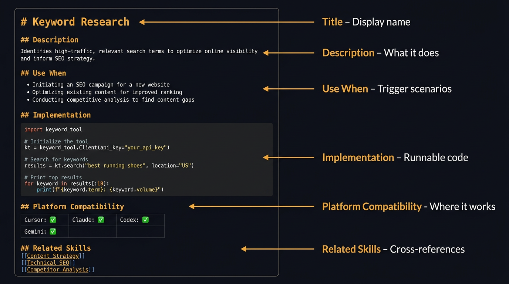
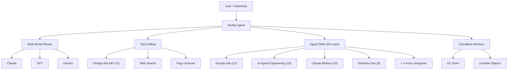

<p align="center">
  
</p>

<p align="center">
  <strong>73 готовых к продакшену навыка для управления Google Ads с помощью ИИ.</strong><br>
  Создано для <a href="https://googleadsagent.ai/tools/auditor/app">Buddy Agent</a> на <a href="https://googleadsagent.ai">googleadsagent.ai</a>. Работает с Claude Code, Cursor, Codex и Gemini.
</p>

[English](README.md) | [Francais](README.fr.md) | [Espanol](README.es.md) | [中文](README.zh.md) | [Nederlands](README.nl.md) | [Русский](README.ru.md) | [한국어](README.ko.md)

---

## Как выглядит навык?

Каждый навык — это один файл `SKILL.md` в именованной директории. Вот реальный навык из этого репозитория — **Keyword Research** (`skills/google-ads/keyword-research/SKILL.md`):

```markdown
# Keyword Research

## Описание

Систематический поиск, расширение и оптимизация ключевых слов для Google Ads.
Формирует вселенные ключевых слов из начальных запросов через семантическое
расширение, анализ конкурентов, анализ поисковых запросов и группировку
по намерениям. Назначает типы соответствия на основе вероятности конверсии
и управляет списками минус-слов на уровне аккаунта, кампании и группы объявлений.

## Когда использовать

- Пользователь просит «исследование ключевых слов» или «идеи ключевых слов»
- Пользователь хочет «расширить ключевые слова» или «найти новые ключевые слова»
- Пользователь упоминает «минус-слова» или «анализ поисковых запросов»
- Пользователь спрашивает о «типах соответствия» (широкое, фразовое, точное)
- Пользователь хочет «сократить нецелевые расходы» на нерелевантные запросы

## Реализация

​```javascript
function assignMatchType(keyword) {
  if (keyword.conversionRate > 0.05 && keyword.volume < 1000)
    return 'EXACT';
  if (keyword.intent === 'transactional' && keyword.wordCount >= 3)
    return 'PHRASE';
  if (keyword.volume > 5000 && keyword.competitorPresence)
    return 'BROAD';
  return 'PHRASE';
}
​```

## Совместимость с платформами

| Платформа   | Поддержка |
|-------------|-----------|
| Cursor      | ✅        |
| Claude Code | ✅        |
| Codex       | ✅        |
| Gemini CLI  | ✅        |

## Связанные навыки

- [Ad Copy Generation](../google-ads/ad-copy-generation/)
- [Competitor Analysis](../google-ads/competitor-analysis/)
- [Quality Score Optimization](../google-ads/quality-score-optimization/)
```

Это полный формат. Каждый навык следует этой структуре:

<p align="center">
  
</p>

Подробности см. в [полной спецификации формата](docs/skill-format.md).

---

## Быстрый старт

### Клонирование и использование

```bash
git clone https://github.com/itallstartedwithaidea/agent-skills.git
cd agent-skills
```

### Валидация всех навыков

```bash
npm run validate
```

### Подсчёт навыков по категориям

```bash
npm run count
```

После клонирования направьте вашего ИИ-агента на директорию `skills/`. Каждый `SKILL.md` — самодостаточный и загружается по запросу.

---

## Каталог навыков

73 навыка в 10 категориях:

| Категория | Навыки | Что охватывает |
|-----------|--------|----------------|
| [Google Ads](skills/google-ads/) | 12 | Аудиты, ключевые слова, рекламные тексты, ставки, PMax, Shopping, аудитории, конверсии, бюджеты, Quality Score, ремаркетинг, анализ конкурентов |
| [AI Agent Engineering](skills/ai-agent-engineering/) | 10 | Инъекция базы знаний, память сущностей, мультимодельная маршрутизация, проактивный интеллект, MCP-серверы, параллельная оркестрация |
| [Claude Mythos](skills/claude-mythos/) | 10 | Архитектура промптов, контекстная инженерия, мастерство инструментов, самовосстанавливающиеся агенты, циклы верификации, когнитивные каркасы |
| [Software Development](skills/software-dev/) | 8 | Код-ревью, TDD, систематическая отладка, git worktrees, мозговой штурм, разработка на субагентах |
| [Scientific Research](skills/scientific-research/) | 8 | Анализ данных, машинное обучение, биоинформатика, хемоинформатика, геопространственный анализ, научное письмо |
| [Web Frontend](skills/web-frontend/) | 6 | Лучшие практики React, React Native, view transitions, edge-деплой, паттерны композиции, веб-дизайн |
| [Productivity](skills/productivity/) | 6 | Оркестрация рабочих процессов, пакетная обработка, RAG-базы знаний, AI-чат-студия, low-code-генерация |
| [Infrastructure](skills/infrastructure/) | 6 | Cloudflare Workers, CI/CD-пайплайны, edge-рендеринг, наблюдаемость, обнаружение сервисов, управление конфигурацией |
| [Security](skills/security/) | 4 | Сканирование безопасности агентов, CodeQL/Semgrep, укрепление песочницы, защита секретов |
| [Media Creative](skills/media-creative/) | 3 | Генерация веб-ассетов, программатик-видео, интеграция ML-моделей |

---

## Формат SKILL.md

Каждый навык требует следующих разделов:

| Раздел | Назначение |
|--------|------------|
| `# Title` | Читаемое название навыка |
| `## Description` | Описание в 2–5 предложениях (индексируется для поиска) |
| `## Use When` | Список сценариев срабатывания |
| `## Implementation` | Фрагменты кода, алгоритмы, процедуры |
| `## Platform Compatibility` | Таблица поддержки Cursor / Claude Code / Codex / Gemini |
| `## Related Skills` | Ссылки на связанные навыки |

Необязательно: `## Prerequisites`, `## Configuration`, `## Best Practices`, `## Limitations`, `## Keywords`

Полная спецификация: [docs/skill-format.md](docs/skill-format.md)

---

## Архитектура

Buddy Agent загружает навыки по запросу на основе распознавания намерений пользователя:



Полная документация по архитектуре: [docs/architecture.md](docs/architecture.md)

---

## Платформа

[googleadsagent.ai](https://googleadsagent.ai) — это ИИ-нативная платформа для управления Google Ads. **Buddy Agent** — интеллектуальный оркестратор в её основе:

- **База знаний на 1 000 паттернов** — экспертные паттерны Google Ads с TF-IDF-сопоставлением, внедряемые в каждый ИИ-вызов
- **Мультимодельная маршрутизация** — Claude, GPT и Gemini с вызовом инструментов на всех трёх провайдерах
- **Память сущностей** — персистентная память, отслеживающая кампании, болевые точки, метрики и решения между сессиями через Cloudflare KV
- **Проактивный интеллект** — ИИ автономно ищет в интернете и повторно запрашивает данные Google Ads в ходе анализа
- **Интеграция Agent Skills** — загружает навыки из этого репозитория по запросу

---

## Участие в проекте

Мы приветствуем вклад в проект. См. [CONTRIBUTING.md](CONTRIBUTING.md) для ознакомления с правилами.

Чтобы добавить новый навык:

1. Создайте директорию в соответствующей категории `skills/`
2. Добавьте `SKILL.md` в соответствии со [спецификацией формата](docs/skill-format.md)
3. Запустите `npm run validate`, чтобы убедиться в прохождении проверки
4. Отправьте pull request

---

## Благодарности

Agent Skills создан с учётом опыта этих open-source проектов:

| Репозиторий | Звёзды | Чему мы научились |
|-------------|--------|-------------------|
| [obra/superpowers](https://github.com/obra/superpowers) | 148k | Архитектура агентов, проектирование автономных рабочих процессов |
| [affaan-m/everything-claude-code](https://github.com/affaan-m/everything-claude-code) | 152k | Лучшие практики Claude Code, промпт-инженерия |
| [vercel-labs/agent-skills](https://github.com/vercel-labs/agent-skills) | 25k | Спецификация формата навыков, архитектура плагинов |
| [K-Dense-AI/scientific-agent-skills](https://github.com/K-Dense-AI/scientific-agent-skills) | 18k | Научная методология валидации навыков |

---

## Лицензия

Лицензия MIT. См. [LICENSE](LICENSE).

---

Создано [John Williams](https://itallstartedwithaidea.com) | Работает на [googleadsagent.ai](https://googleadsagent.ai)
