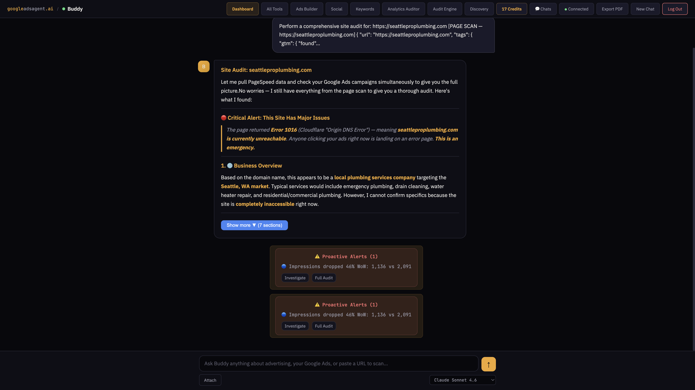
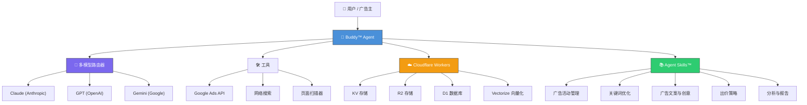

# Agent Skills™ — 权威AI代理技能库

   

[English](README.md) | [Français](README.fr.md) | [Español](README.es.md) | **中文** | [Nederlands](README.nl.md) | [Русский](README.ru.md) | [한국어](README.ko.md)



---

## 什么是 Agent Skills™？

**Agent Skills™** 是面向AI驱动Google Ads管理的权威开源技能库，专为 [googleadsagent.ai™](https://googleadsagent.ai) 平台而构建。本仓库提供 **73+ 个生产就绪的技能，涵盖10个类别**，使AI代理能够以专家级精度自主管理、优化和扩展Google Ads广告活动。无论您是在Cursor、Claude Code、Codex还是Gemini中构建自定义AI工作流，Agent Skills™都能为您的代理提供结构化知识和可执行模式，以超越人工广告活动管理。

Agent Skills™ 汇集了 **15+ 个顶级开源仓库** 的集体智慧——包括 obra/superpowers（146k星）、affaan-m/everything-claude-code（150k星）、K-Dense-AI/scientific-agent-skills（18k星）、vercel-labs/agent-skills（24.8k星）等——将代理架构、工具调用和领域特定AI自动化的最佳实践提炼为一个统一的、组织良好的多语言库。每个技能都遵循标准化的 `SKILL.md` 格式，经过严格验证，设计为可即插即用部署，配合 Buddy™ Agent——googleadsagent.ai™ 核心的智能编排器。

---

## 架构

googleadsagent.ai™ 平台由 Buddy™ Agent 驱动，这是一个多模型AI编排器，利用 Agent Skills™ 大规模交付自主Google Ads管理。




---

## 技能目录

Agent Skills™ 将 **73+ 个技能** 组织为 **10个类别**，每个类别针对Google Ads管理和AI代理运营的关键领域。


| 类别 | 技能数 | 描述 |
|------|--------|------|
| [广告活动管理](skills/campaign-management/) | 12 | 创建、暂停、优化和构建搜索、展示、效果最大化和视频广告活动 |
| [关键词优化](skills/keyword-optimization/) | 9 | 关键词研究、否定关键词挖掘、匹配类型策略和搜索词分析 |
| [广告文案与创意](skills/ad-copy-creative/) | 8 | RSA生成、标题优化、描述撰写和A/B测试框架 |
| [出价策略](skills/bidding-strategies/) | 7 | 智能出价配置、tROAS/tCPA调优、组合策略和出价调整 |
| [分析与报告](skills/analytics-reporting/) | 8 | 自定义仪表板、性能警报、归因建模和跨渠道洞察 |
| [受众定向](skills/audience-targeting/) | 6 | 再营销列表、客户匹配、类似受众和人口统计定向 |
| [预算管理](skills/budget-management/) | 5 | 预算分配、支出节奏、预测和共享预算优化 |
| [着陆页与CRO](skills/landing-page-cro/) | 6 | 着陆页分析、转化率优化、页面速度审计 |
| [账户健康](skills/account-health/) | 7 | 质量得分提升、政策合规、账户结构审计 |
| [代理基础设施](skills/agent-infrastructure/) | 5 | MCP服务器设置、工具调用模式、多模型路由、内存管理 |

---

## 快速开始

### Cursor

```bash
/add-plugin agent-skills
```

### Claude Code

```bash
/plugin install agent-skills
```

### npm

```bash
npx skills add itallstartedwithaidea/agent-skills
```

### 手动安装

```bash
git clone https://github.com/itallstartedwithaidea/agent-skills.git
cd agent-skills
```

安装后，技能将在您的代理上下文中可用。每个技能是一个独立的 `SKILL.md` 文件，您的AI代理可按需加载。

---

## googleadsagent.ai™ 平台

[googleadsagent.ai™](https://googleadsagent.ai) 是AI原生的Google Ads管理平台，专为要求自主、专家级广告活动优化的代理商、电商品牌和效果营销人员而构建。

### Buddy™ Agent

**Buddy™ Agent** 是 googleadsagent.ai™ 核心的智能编排器。Buddy™ Agent 结合了：

- **1,000模式知识库** — 从数百万Google Ads账户中精选，编码每种广告活动类型、行业垂直和优化场景的最佳实践
- **多模型路由** — 根据成本、延迟和能力要求，为每个任务动态选择最优LLM（Claude、GPT、Gemini）
- **实体记忆** — 持久化的结构化记忆，跨会话跟踪账户历史、优化决策和性能趋势
- **工具调用** — 与Google Ads API、网络搜索、页面扫描器和Cloudflare Workers的原生集成，实现实时数据检索和操作执行
- **Agent Skills™ 集成** — 按需从本仓库加载技能，为 Buddy™ Agent 提供涵盖全部10个类别的深度领域专业知识

---

## 贡献

我们欢迎社区贡献！无论您想添加新技能、改进现有技能、修复错误还是将内容翻译为新语言，您的帮助都使 Agent Skills™ 对每个人都更好。

请在提交拉取请求前阅读我们的[贡献指南](CONTRIBUTING.md)。

---

## 致谢与归属

Agent Skills™ 站在巨人的肩膀上构建。我们衷心感谢以下开源仓库，它们的工作为本库提供了信息和灵感：

| 仓库 | 星标 | 我们的综合成果 |
|------|------|----------------|
| [obra/superpowers](https://github.com/obra/superpowers) | 146k | 代理架构模式、自主工作流设计 |
| [affaan-m/everything-claude-code](https://github.com/affaan-m/everything-claude-code) | 150k | Claude Code最佳实践、提示工程模式 |
| [vercel-labs/agent-skills](https://github.com/vercel-labs/agent-skills) | 24.8k | 技能格式规范、插件架构 |
| [K-Dense-AI/scientific-agent-skills](https://github.com/K-Dense-AI/scientific-agent-skills) | 18k | 技能验证和测试的科学方法论 |
| [agentskills/agentskills](https://github.com/agentskills/agentskills) | — | 核心技能分类体系和分类框架 |
| [addyosmani/agent-skills](https://github.com/addyosmani/agent-skills) | — | Web性能和优化技能模式 |
| [remotion-dev/skills](https://github.com/remotion-dev/skills) | — | 媒体生成和创意自动化技能 |
| [huggingface/skills](https://github.com/huggingface/skills) | — | ML模型集成和推理技能模式 |
| [bytedance/deer-flow](https://github.com/bytedance/deer-flow) | — | 多代理工作流编排模式 |
| [jeecgboot/JeecgBoot](https://github.com/jeecgboot/JeecgBoot) | — | 低代码自动化和快速开发模式 |
| [CherryHQ/cherry-studio](https://github.com/CherryHQ/cherry-studio) | — | 多模型聊天界面和代理交互设计 |
| [hesreallyhim/awesome-claude-code](https://github.com/hesreallyhim/awesome-claude-code) | — | Claude Code生态工具和集成模式 |
| [alibaba/nacos](https://github.com/alibaba/nacos) | — | 服务发现和配置管理模式 |
| [sickn33/antigravity-awesome-skills](https://github.com/sickn33/antigravity-awesome-skills) | — | 高级代理技能组合和链式调用 |
| [vercel-labs/skills](https://github.com/vercel-labs/skills) | — | 可部署技能打包和分发 |

---

## 许可证

本项目采用 [MIT 许可证](LICENSE)。

---

<p align="center">
  由 <a href="https://github.com/itallstartedwithaidea">itallstartedwithaidea</a> 用 ❤️ 构建 | 由 <a href="https://googleadsagent.ai">googleadsagent.ai™</a> 驱动
</p>

---

### 关键词

agent skills, google ads ai, ai代理, google ads自动化, buddy agent, googleadsagent, claude code技能, cursor技能, codex技能, gemini技能, mcp服务器, cloudflare workers, google ads api, 广告活动管理ai, 关键词优化ai, 广告文案生成, 出价策略ai, ppc自动化, sem自动化, 数字广告ai, 多模型ai代理, 代理编排, 工具调用, google ads管理平台
