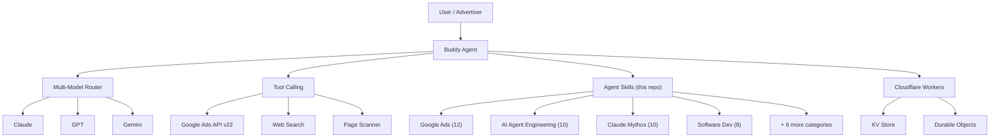

<p align="center">
  
</p>

<p align="center">
  <strong>73 个生产就绪的 AI 驱动 Google Ads 管理技能。</strong><br>
  专为 <a href="https://googleadsagent.ai/tools/auditor/app">Buddy Agent</a> 打造，来自 <a href="https://googleadsagent.ai">googleadsagent.ai</a>。兼容 Claude Code、Cursor、Codex 和 Gemini。
</p>

[English](README.md) | [Francais](README.fr.md) | [Espanol](README.es.md) | [中文](README.zh.md) | [Nederlands](README.nl.md) | [Русский](README.ru.md) | [한국어](README.ko.md)

---

## 技能长什么样？

每个技能都是一个命名目录中的单个 `SKILL.md` 文件。以下是本仓库中的一个真实技能示例 — **Keyword Research**（`skills/google-ads/keyword-research/SKILL.md`）：

```markdown
# Keyword Research

## Description

Systematic keyword discovery, expansion, and optimization for Google Ads.
Builds keyword universes from seed keywords through semantic expansion,
competitor mining, search term analysis, and intent-based grouping.
Assigns match types based on conversion probability and manages negative
keyword lists at account, campaign, and ad group levels.

## Use When

- User asks for "keyword research" or "keyword ideas"
- User wants to "expand keywords" or "find new keywords"
- User mentions "negative keywords" or "search term mining"
- User asks about "match types" (broad, phrase, exact)
- User wants to "reduce wasted spend" on irrelevant queries

## Implementation

​```javascript
function assignMatchType(keyword) {
  if (keyword.conversionRate > 0.05 && keyword.volume < 1000)
    return 'EXACT';
  if (keyword.intent === 'transactional' && keyword.wordCount >= 3)
    return 'PHRASE';
  if (keyword.volume > 5000 && keyword.competitorPresence)
    return 'BROAD';
  return 'PHRASE';
}
​```

## Platform Compatibility

| Platform    | Supported |
|-------------|-----------|
| Cursor      | ✅        |
| Claude Code | ✅        |
| Codex       | ✅        |
| Gemini CLI  | ✅        |

## Related Skills

- [Ad Copy Generation](../google-ads/ad-copy-generation/)
- [Competitor Analysis](../google-ads/competitor-analysis/)
- [Quality Score Optimization](../google-ads/quality-score-optimization/)
```

以上就是完整的格式。每个技能都遵循这一结构：

<p align="center">
  
</p>

查看[完整格式规范](docs/skill-format.md)了解详情。

---

## 快速开始

### 克隆并直接使用

```bash
git clone https://github.com/itallstartedwithaidea/agent-skills.git
cd agent-skills
```

### 验证所有技能

```bash
npm run validate
```

### 按类别统计技能数量

```bash
npm run count
```

克隆后，将你的 AI 代理指向 `skills/` 目录。每个 `SKILL.md` 都是独立的，可按需加载。

---

## 技能目录

73 个技能，涵盖 10 个类别：

| 类别 | 技能数 | 涵盖内容 |
|------|--------|----------|
| [Google Ads](skills/google-ads/) | 12 | 审计、关键词、广告文案、出价、PMax、Shopping、受众、转化、预算、Quality Score、再营销、竞争对手分析 |
| [AI Agent Engineering](skills/ai-agent-engineering/) | 10 | 知识库注入、实体记忆、多模型路由、主动智能、MCP 服务器、并行编排 |
| [Claude Mythos](skills/claude-mythos/) | 10 | 提示词架构、上下文工程、工具精通、自修复代理、验证循环、认知脚手架 |
| [Software Development](skills/software-dev/) | 8 | 代码审查、TDD、系统化调试、git worktrees、头脑风暴、子代理驱动开发 |
| [Scientific Research](skills/scientific-research/) | 8 | 数据分析、机器学习、生物信息学、化学信息学、地理空间分析、科学写作 |
| [Web Frontend](skills/web-frontend/) | 6 | React 最佳实践、React Native、视图过渡、边缘部署、组合模式、网页设计 |
| [Productivity](skills/productivity/) | 6 | 工作流编排、批处理、RAG 知识库、AI 聊天工作室、低代码生成 |
| [Infrastructure](skills/infrastructure/) | 6 | Cloudflare Workers、CI/CD 流水线、边缘渲染、可观测性、服务发现、配置管理 |
| [Security](skills/security/) | 4 | 代理安全扫描、CodeQL/Semgrep、沙箱加固、密钥保护 |
| [Media Creative](skills/media-creative/) | 3 | 网页素材生成、程序化视频、ML 模型集成 |

---

## SKILL.md 格式

每个技能需要以下部分：

| 部分 | 用途 |
|------|------|
| `# Title` | 人类可读的技能名称 |
| `## Description` | 2-5 句的说明（用于搜索索引） |
| `## Use When` | 触发场景的项目符号列表 |
| `## Implementation` | 代码片段、算法、操作步骤 |
| `## Platform Compatibility` | Cursor / Claude Code / Codex / Gemini 兼容性表格 |
| `## Related Skills` | 相关技能的链接 |

可选部分：`## Prerequisites`、`## Configuration`、`## Best Practices`、`## Limitations`、`## Keywords`

完整规范：[docs/skill-format.md](docs/skill-format.md)

---

## 架构

Buddy Agent 根据用户意图匹配按需加载技能：



完整架构文档：[docs/architecture.md](docs/architecture.md)

---

## 平台介绍

[googleadsagent.ai](https://googleadsagent.ai) 是 AI 原生的 Google Ads 管理平台。**Buddy Agent** 是其核心的智能编排器：

- **1,000 模式知识库** — 专业的 Google Ads 模式，通过 TF-IDF 匹配注入每次 AI 调用
- **多模型路由** — Claude、GPT 和 Gemini，三个提供商均支持工具调用
- **实体记忆** — 通过 Cloudflare KV 在会话间持久追踪广告系列、痛点、指标和决策
- **主动智能** — AI 在分析过程中自主搜索网络并重新获取 Google Ads 数据
- **Agent Skills 集成** — 按需从本仓库加载技能

---

## 贡献

我们欢迎贡献。请查看 [CONTRIBUTING.md](CONTRIBUTING.md) 了解指南。

添加新技能的步骤：

1. 在 `skills/` 的相应类别下创建一个目录
2. 按照[格式规范](docs/skill-format.md)添加 `SKILL.md`
3. 运行 `npm run validate` 确认通过验证
4. 提交 pull request

---

## 致谢

Agent Skills 受到以下开源项目的启发：

| 仓库 | 星标数 | 我们学到了什么 |
|------|--------|----------------|
| [obra/superpowers](https://github.com/obra/superpowers) | 148k | 代理架构、自主工作流设计 |
| [affaan-m/everything-claude-code](https://github.com/affaan-m/everything-claude-code) | 152k | Claude Code 最佳实践、提示词工程 |
| [vercel-labs/agent-skills](https://github.com/vercel-labs/agent-skills) | 25k | 技能格式规范、插件架构 |
| [K-Dense-AI/scientific-agent-skills](https://github.com/K-Dense-AI/scientific-agent-skills) | 18k | 技能验证的科学方法论 |

---

## 许可证

MIT 许可证。详见 [LICENSE](LICENSE)。

---

由 [John Williams](https://itallstartedwithaidea.com) 构建 | 由 [googleadsagent.ai](https://googleadsagent.ai) 驱动
