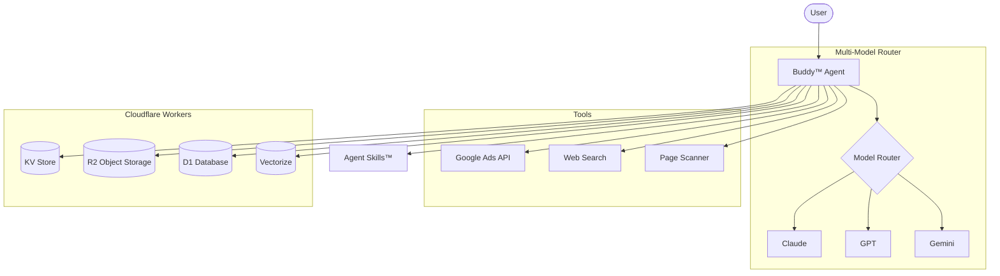
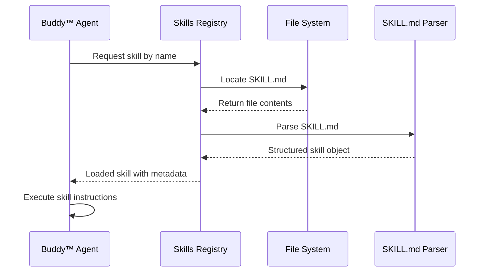
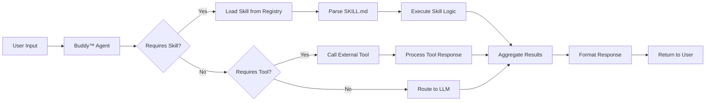

# Agent Skills™ Architecture

> Maintained by [googleadsagent.ai™](https://googleadsagent.ai)

## Overview

Agent Skills™ is the open-source skill layer that powers the Buddy™ Agent — the AI-driven advertising assistant built by googleadsagent.ai™. The architecture is designed around three core principles: **modularity** (skills are self-contained units), **multi-model flexibility** (the agent routes to the best LLM for each task), and **edge-first infrastructure** (everything runs on Cloudflare Workers for global low-latency execution).

The system consists of four interconnected layers:

1. **Agent Layer** — The Buddy™ Agent orchestrates conversations, tool calls, and skill execution.
2. **Model Layer** — A multi-model router dispatches requests to Claude, GPT, or Gemini based on task requirements.
3. **Tool Layer** — Native integrations with Google Ads API, web search, page scanning, and other services.
4. **Infrastructure Layer** — Cloudflare Workers with KV, R2, D1, and Vectorize provide stateless compute, caching, object storage, relational data, and vector search.

## System Architecture

## Skills Loading

When the Buddy™ Agent needs a skill, it goes through a structured loading pipeline. The Skills Registry maintains an index of all available skills, resolves the correct `SKILL.md` file, parses its structured content, and hands the parsed instructions back to the agent for execution.

The Skills Registry supports both local file system access (for development and self-hosted deployments) and remote loading via R2 object storage (for production edge deployments). Parsed skills are cached in KV with a configurable TTL to minimize cold-start latency.

## Multi-Model Routing

The Buddy™ Agent does not rely on a single LLM. Instead, it employs a multi-model routing strategy that selects the optimal model for each task based on several factors:

- **Task complexity** — Simple classification and extraction tasks route to faster, lower-cost models. Complex reasoning, multi-step planning, and code generation route to more capable models.
- **Domain specialization** — Tasks requiring deep knowledge of Google Ads policies or advertising best practices may route to models fine-tuned or prompted with domain-specific context.
- **Latency requirements** — Real-time conversational responses favor low-latency models, while background analysis tasks can tolerate longer execution times.
- **Cost optimization** — The router balances quality against cost, defaulting to the most cost-effective model that meets the quality threshold for each task type.

The routing decision is made before each LLM call and is transparent to the user. The agent maintains a unified conversation context regardless of which model handles individual turns.

## Data Flow

The following diagram illustrates how a typical user request flows through the system from input to response:

Key data flow characteristics:

- **Stateless compute**: Each request is handled independently by a Cloudflare Worker. Conversation state is persisted in D1 and retrieved on each turn.
- **Streaming responses**: LLM responses are streamed back to the user in real time via Server-Sent Events (SSE).
- **Parallel tool calls**: When a skill requires multiple tool calls, they are executed concurrently to minimize total latency.
- **Error isolation**: Tool failures are caught and reported gracefully without terminating the overall agent response.

## Infrastructure

The entire Buddy™ Agent platform runs on Cloudflare's edge network, providing sub-50ms latency to users worldwide.

### Cloudflare Workers

The core compute layer. Each incoming request is handled by a Worker that orchestrates the agent loop — parsing input, loading skills, routing to models, calling tools, and streaming responses. Workers are stateless and scale automatically.

### KV (Key-Value Store)

Used for:
- **Skill caching** — Parsed `SKILL.md` files are cached in KV to avoid repeated file reads and parsing.
- **Session metadata** — Lightweight session data such as user preferences and feature flags.
- **Rate limiting** — Request counters for API rate limiting with automatic TTL expiration.

### R2 (Object Storage)

Used for:
- **Skill storage** — The canonical source of all `SKILL.md` files in production deployments.
- **Asset storage** — Images, reports, and generated artifacts referenced by skills.
- **Audit logs** — Compressed logs of agent interactions for compliance and debugging.

### D1 (SQL Database)

Used for:
- **Conversation history** — Full conversation threads with message metadata.
- **User accounts** — Authentication records, API keys, and billing information.
- **Skill analytics** — Usage counts, success rates, and performance metrics for each skill.
- **Campaign data cache** — Locally cached Google Ads campaign structures for fast lookups.

### Vectorize

Used for:
- **Semantic skill search** — Skills are embedded and indexed so the agent can find the most relevant skill for ambiguous or natural-language requests.
- **Knowledge retrieval** — RAG (Retrieval-Augmented Generation) over Google Ads documentation, help articles, and best-practice guides.
- **Conversation memory** — Long-term semantic memory across sessions for personalized agent behavior.
